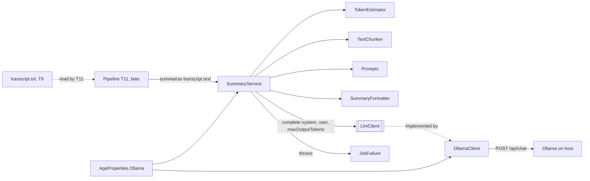

# T10 components

## What changes

| Component | Change | Why there |
|---|---|---|
| `summary/LlmClient` (new, public interface) | `complete(system, user, maxOutputTokens)` returns `LlmReply(content, promptTokens)`; throws `LlmException`. No Ollama types. | SPEC: the backend must be swappable. `SummaryService` knows nothing about Ollama JSON. |
| `summary/LlmReply` (new record), `summary/LlmException` (new, checked) | Reply carries the non-blank content and the prompt token count. The exception carries a `Reason` (`CONNECTION`, `TIMEOUT`, `OTHER`). | Lets `SummaryService` choose the `JobFailure` kind without JDK exception types (same idea as `WhisperException`). |
| `summary/OllamaClient` (new) | One `POST /api/chat` with the JDK `HttpClient`. Sets model, `num_ctx`, `think:false`, `stream:false` on every call. Validates the answer (status, JSON, content, token count). | Isolates HTTP/JSON so it is tested on WireMock. |
| `summary/SummaryService` (new, public entry point) | Budget, split, map, reduce (several rounds if needed), truncation check, output normalization and the 1,500-character cap. Maps `LlmException` to `JobFailure`. | The only class T11 calls. |
| `summary/TokenEstimator` (new, package-private, static) | The one size formula, used for the budget and for the truncation check. | Both checks must use the same arithmetic. |
| `summary/TextChunker` (new, package-private, static) | Pure: splits text into ordered chunks of at most N characters. | Pure unit tests (boundaries, one long word, surrogate pairs). |
| `summary/SummaryFormatter` (new, package-private, static) | Pure: normalizes bullets and applies the cap. | Pure unit tests. |
| `summary/Prompts` (new, package-private) | The three system prompts (short, map, reduce). | Listed in the task files. |
| `job/JobFailure` | New kind `SUMMARY_UNREACHABLE`; new factory `summaryFailed(Throwable)` (kind `FAILED`, own message). | The transcription copy ("transcription server") must not describe an Ollama outage. Typed hook for the later DLQ task. |
| `config/AppProperties` | `Ollama(baseUrl, model, numCtx, timeout)`. | Two new settings. |
| `config/SummaryConfig` (new) | Beans `LlmClient` (`OllamaClient`) and `SummaryService`. | Same pattern as `TranscriptConfig`. |
| `application.yml` | `app.ollama.num-ctx: ${OLLAMA_NUM_CTX:8192}`, `app.ollama.timeout: ${OLLAMA_TIMEOUT:PT10M}`. | `application-dev.yml` unchanged. |
| `SPEC.md` (orchestrator) | List `OLLAMA_NUM_CTX` and `OLLAMA_TIMEOUT` in the env var line. | Same as `WHISPER_TIMEOUT` in T9. |
| `docs/decisions.md` | D8 (added by the Architect). | |

Not changed: `transcript/*`, `media/*`, `job/*` store and queue, `bot/*`. T10 is not wired into any flow (T11 does that), so there is no user-visible behaviour and no functional `*IT`.

## Diagram

