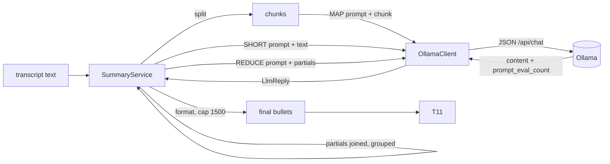

# T10 data flow

| Data | From → to | Format | Stored |
|---|---|---|---|
| Transcript | T11 (read from `transcript.txt`) → `SummaryService.summarize(String)` | UTF-8 text | not stored by T10 |
| Chunks | `TextChunker` → `SummaryService` | `List<String>`, each at most `maxChunkChars` | memory only |
| System prompt + user text + `maxOutputTokens` | `SummaryService` → `LlmClient` | Java arguments | memory only |
| Chat request | `OllamaClient` → Ollama | JSON, `POST /api/chat` (see `api.md`) | no |
| Chat answer | Ollama → `OllamaClient` | JSON; only `message.content`, `prompt_eval_count` are read | no |
| `LlmReply(content, promptTokens)` | `OllamaClient` → `SummaryService` | record | memory only |
| Partial summaries | `SummaryService` (map and round outputs) | trimmed text, clipped to `partialMaxChars` | memory only |
| Final summary | `SummaryService` → T11 | `String`, `• ` lines, at most 1,500 chars | T11 puts it into the message and `job.json` |
| `JobFailure` | `SummaryService` → T11 | typed exception | no |

Nothing is written to disk. Transcript text and answers are never logged (only status codes, a 200-char body prefix on non-2xx, counts and sizes).

