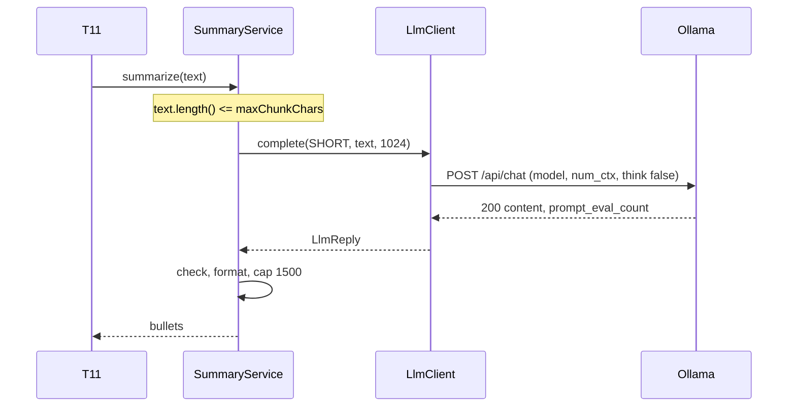
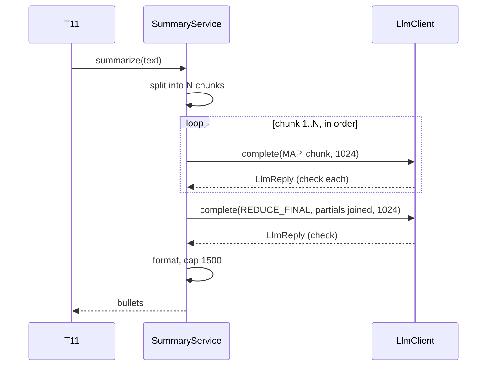
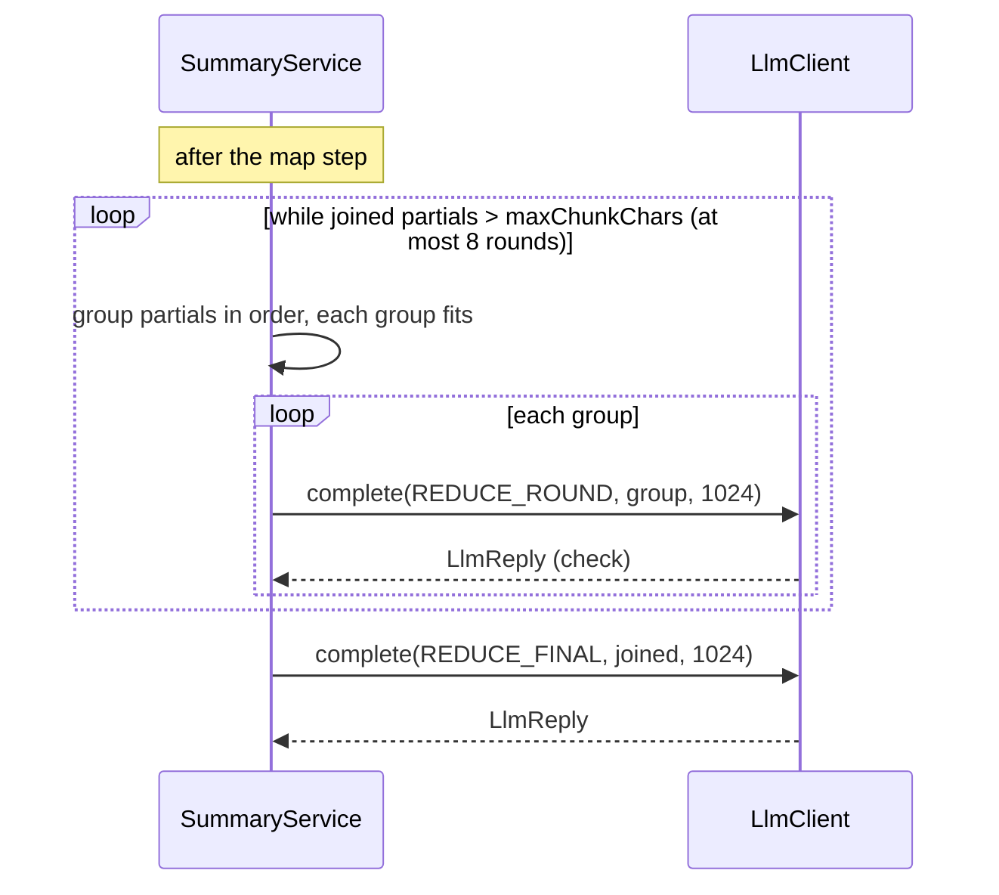
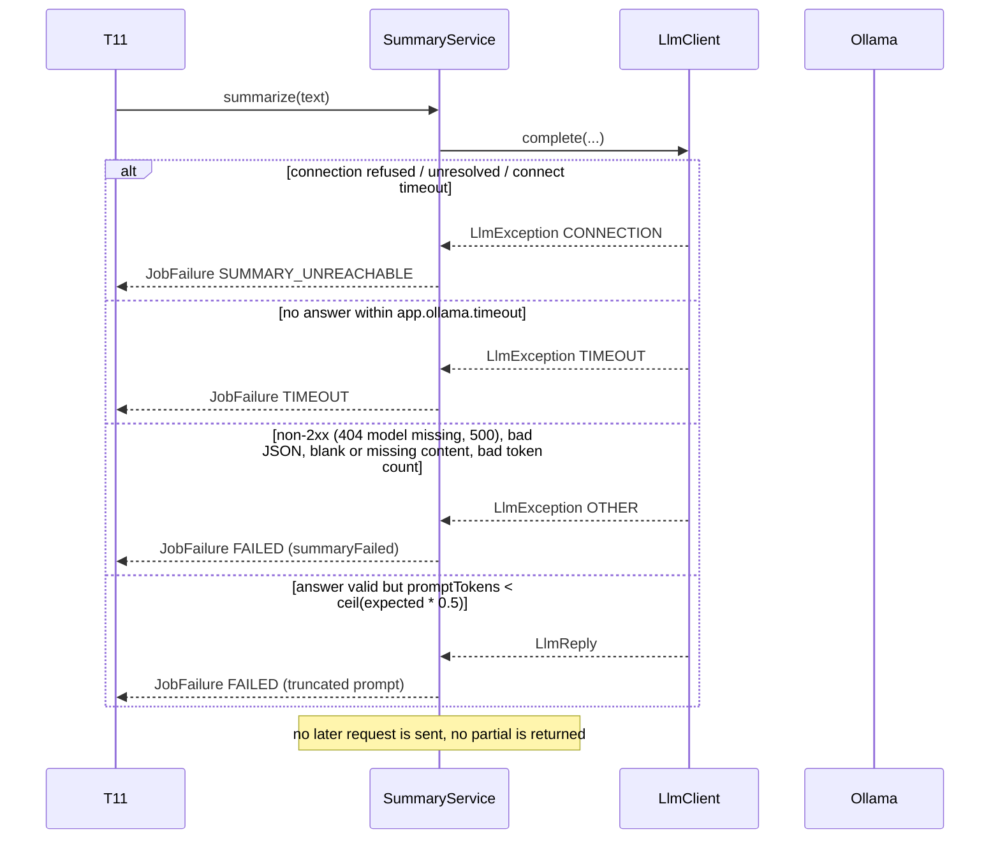

# T10 flows

`LlmClient` below is `OllamaClient` in production. "check" is the truncation check from `api.md`.

## 1. Short transcript (main)

## 2. Long transcript, partials fit one reduction (main)

Total requests: N + 1.

## 3. Partials do not fit one request (further reduction)

Every group has at least 2 partials (guaranteed by the constructor rule), so each round shrinks the list. More than 8 rounds: `FAILED`.

## 4. Failures (any call: short, map, round or final)

## 5. Invalid input and settings

- Constructor: `numCtx <= 0` or `textBudget < 2 * 1024` → `IllegalArgumentException` at start, no request.
- `summarize(null)` → `NullPointerException`. Blank transcript → `JobFailure FAILED`, no request.
- Answer with no usable bullet line after normalization → `FAILED`.

## 6. Output formatting

Final answer only: strip lines, drop blanks and one leading marker, prefix `• `, join with `\n`; over 1500 UTF-16 units → drop trailing bullets; a single bullet over 1500 → cut to 1499 (no split surrogate) plus `…`.

## Traceability to the Analyst's requirements

R1: flow 1-3, `OllamaClient` request. R2: Budget, `TextChunker`, flow 5. R3: flows 1-3, request counts. R4: `OllamaClient` mapping table. R5: truncation check in `SummaryService`. R6: `SummaryFormatter`. R7: flow 4 and the failure table. The `T10-summary.feature` scenarios (future, via T11) go through the same flows; T10 itself is covered by `OllamaClientTest` and `SummaryServiceTest`.
