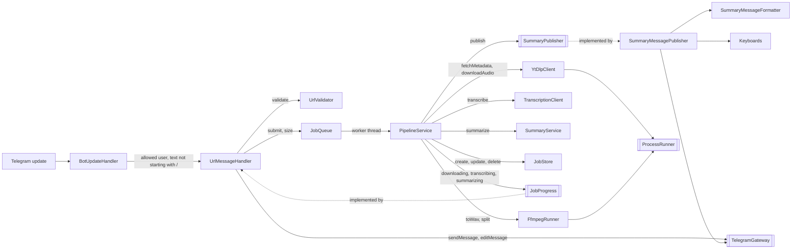

# T11 components

## What changes

| Component | Change | Why there |
|---|---|---|
| `job/PipelineService` (new) | `run(...)` does the whole job for one link: create the job directory, metadata, download, WAV, chunks, transcription, summary, write `job.json`, publish the summary, start the retention clock. On any failure it deletes the job directory and throws a `JobFailure`. | One place owns the order of the stages and the cleanup. It lives in `job/` and knows nothing about Telegram. |
| `job/JobProgress` (new interface) | Three callbacks: `downloading()`, `transcribing(n, total)`, `summarizing()`. | Lets the pipeline report stages without importing `bot/`. |
| `job/SummaryPublisher` (new interface) | `int publish(JobRecord job, String summary)`: sends the summary message and returns its message id. | Same reason: the pipeline needs the Telegram send but must not depend on `bot/`. |
| `bot/UrlMessageHandler` (new) | Takes the text of an allowed user's message, validates the link, sends the first status message, queues the job, edits the status message through the stages (as the `JobProgress`), and after the job has left the queue sends the failure message or the final status. | The Telegram side of the flow. |
| `bot/SummaryMessageFormatter` (new, package-private, static) | Builds the summary HTML (title clipped, duration, bullets, escaping) and the clipped title. Pure. | Pure unit tests; the 4,096-character rule lives in one place. |
| `bot/SummaryMessagePublisher` (new) | `SummaryPublisher` over `TelegramGateway`: `sendMessage(chatId, html, Keyboards.delivery(jobId))`. | Keeps the gateway out of `job/`. |
| `bot/Keyboards` | New `delivery(jobId)` and constants `AUDIO_PREFIX = "audio:"`, `TRANSCRIPT_PREFIX = "transcript:"`. | T12/T13 read the same constants. |
| `bot/BotUpdateHandler` | Constructor takes a `UrlMessageHandler`. An allowed user's text message that is not a command (does not start with `/`) goes to `UrlMessageHandler.handle(sender, text)`. | Today such a message is dropped. |
| `config/PipelineConfig` (new) | Beans `PipelineService`, `SummaryPublisher`, `UrlMessageHandler`. Same `@ConditionalOnProperty(app.telegram.enabled)` as `TelegramConfig`. | The publisher needs the gateway, which exists only when the bot is enabled. |
| `config/TelegramConfig` | `botUpdateHandler(...)` takes the `UrlMessageHandler`. | Wiring. |
| `config/JobConfig` | No change (`JobStore`, `JobQueue`, `Clock` already exist). | |
| `job/JobRecord` and `job/JobStore` | No change. `JobRecord.published(...)` and `JobStore.update` are used as they are. | |
| `media/*`, `transcript/*`, `summary/*`, `AppProperties`, `application.yml` | No change. | |
| `src/it` harness (Tester) | A `ProcessRunner` bean that decorates `DefaultProcessRunner` and adds `--proxy` to `yt-dlp` calls; a fake one for failures that cannot be made for real; a WireMock server for the media fixtures; steps for T8, T9, T10 and TD2; `CucumberIT` filter reduced to `not @manual_media`. | TD4 and the T11 acceptance text. Tester-owned. |

Not changed: access control, `AccessAdmin`, `JobQueue` (T11 only reads `size()` and uses `submit`).

Out of scope (later tasks): the button taps (T12, T13; until then a tap on the new buttons is ignored, as every unknown callback is today), the sweeper and restart recovery (T14), the dead-letter queue.

## Diagram

