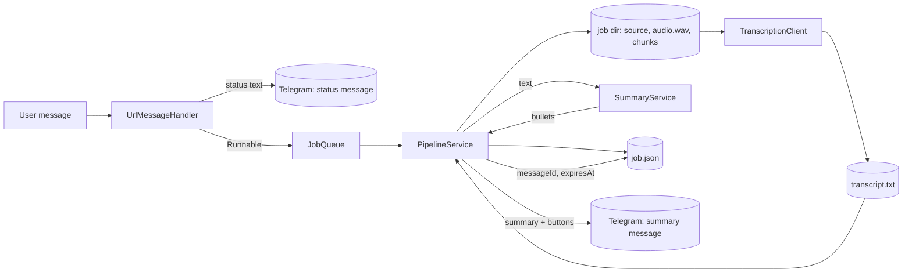

# T11 data flow

| From → to | Data | Format | Stored where |
|---|---|---|---|
| Telegram → `BotUpdateHandler` | message text, sender id, chat id | Telegram `Update` | not stored |
| `UrlMessageHandler` → `JobQueue` | one `Runnable` that runs `PipelineService.run` | in memory | the queue |
| `UrlMessageHandler` → Telegram | status message (HTML, no buttons), later edits | `sendMessage`, `editMessage` | message id kept in memory by the handler for this job |
| `PipelineService` → `YtDlpClient` / `FfmpegRunner` | URL, job directory | `Path`, `String` | files below |
| `PipelineService` → `TranscriptionClient` | chunk paths, progress callback | `List<Path>` | `transcript.txt` |
| `PipelineService` → `SummaryService` | transcript text read from `transcript.txt` (UTF-8) | `String` | not stored |
| `PipelineService` → `JobStore` | the job record, written once the summary exists | `job.json` | job directory |
| `PipelineService` → `SummaryPublisher` | job record and summary bullets | `JobRecord`, `String` | not stored |
| `SummaryMessagePublisher` → Telegram | summary HTML with two buttons | `sendMessage` | message id goes into `job.json` |

## Files in `<WORK_DIR>/<jobId>/`

| File | Written by | Lives until |
|---|---|---|
| `source.<ext>` | `YtDlpClient` | retention (T14) or a failure |
| `audio.wav`, `chunks/chunk-NNN.wav` | `FfmpegRunner` | deleted by `TranscriptionClient` after `transcript.txt` is written |
| `transcript.txt` | `TranscriptionClient` | retention (T14) or a failure |
| `job.json` | `PipelineService` | retention (T14) or a failure |

`job.json` does not exist while the job runs; it is created after the summary text exists and before the summary message is sent. A directory without `job.json` is "no such job" for the store. This is already handled by T7 and by T14 at startup.

## `job.json` written by T11 (a `JobRecord`, written by `JobStore`)

```json
{
  "jobId": "<uuid>",
  "ownerUserId": 1001,
  "chatId": 1001,
  "summaryMessageId": null,
  "title": "<video title, unchanged>",
  "durationSeconds": 300,
  "createdAt": "<instant the job was accepted>",
  "files": {
    "AUDIO":      { "path": "source.m4a",     "state": "AVAILABLE", "expiresAt": null, "sentAt": null },
    "TRANSCRIPT": { "path": "transcript.txt", "state": "AVAILABLE", "expiresAt": null, "sentAt": null }
  }
}
```

After the summary message is sent the record is updated with `JobRecord.published(messageId, sentAt + retention)`: `summaryMessageId` is the id Telegram returned and both files get `expiresAt = sentAt + app.jobs.retention` (default `PT1H`), where `sentAt = clock.instant()` read right after `sendMessage` returned. `AUDIO.path` is the file name of the path `YtDlpClient.downloadAudio` returned (for example `source.m4a` or `source.mp4`).


