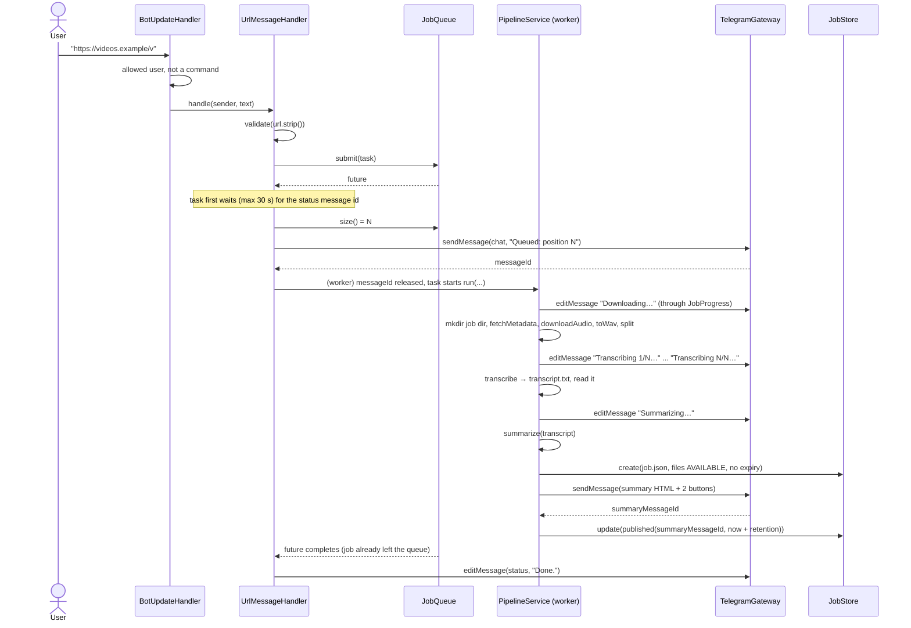
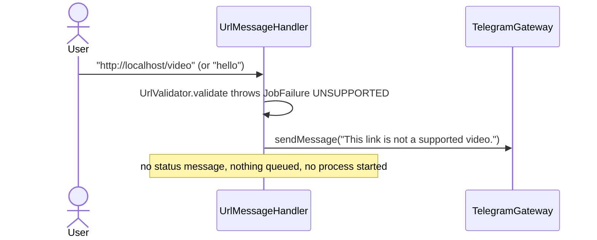
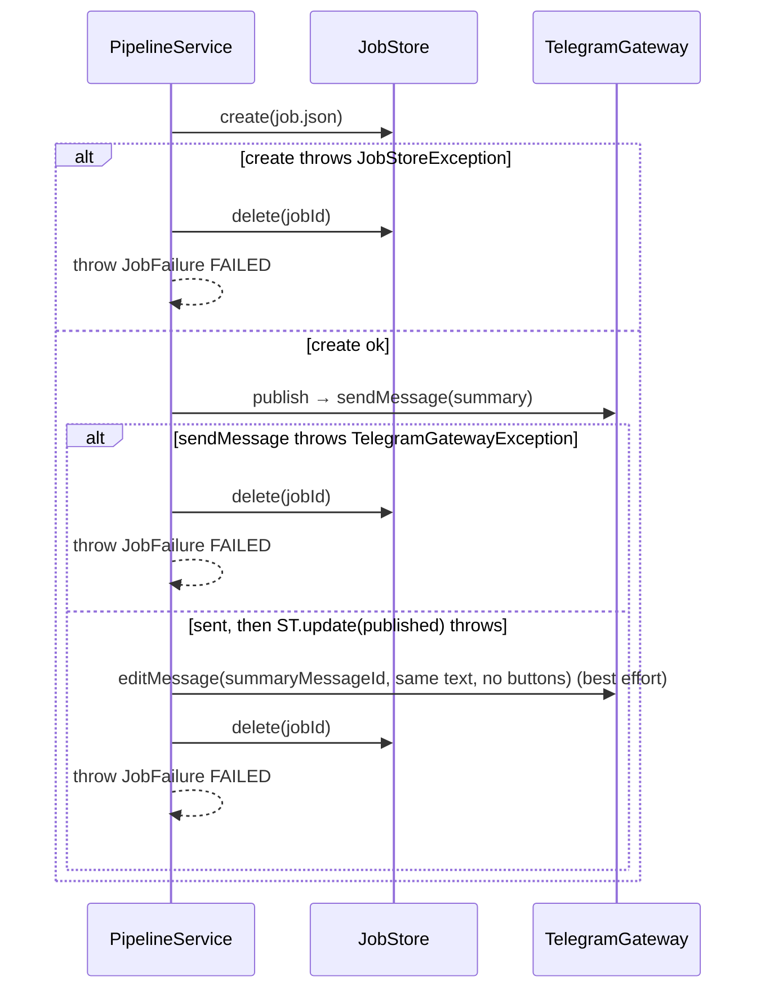
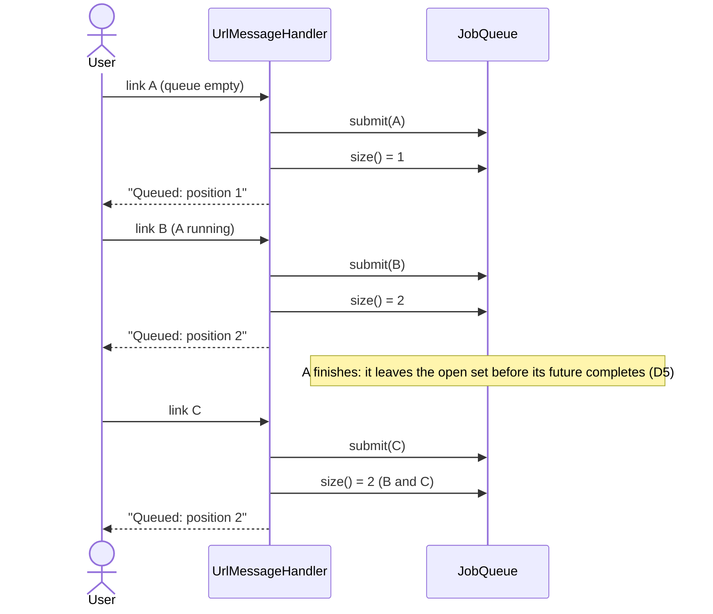

# T11 flows

Thread notes: `BotUpdateHandler` runs on the Telegram consumer thread (in the functional tests, on the test thread). Everything in `PipelineService` runs on the `job-worker` thread. The final status edit and the failure message run on a third thread (see F1), after the job has left the queue.

## F1: success



The first status message is the acknowledgement. It is sent before any media work, so it arrives within 5 seconds of the message (one Telegram call after a URL check that does no I/O).

Why the worker waits for the message id: `size()` has to be read after `submit` (the position includes the new job), and the status message has to exist before the worker edits it. The task therefore starts by waiting on a `CompletableFuture<Integer>` that the handler completes after `sendMessage` returns. If the send fails the future is completed exceptionally and the task ends without doing anything (F5).

## F2: link rejected before queueing



## F3: failure during the job (metadata, download, ffmpeg, Whisper, Ollama, limits)

```mermaid
sequenceDiagram
  participant UH as UrlMessageHandler
  participant PS as PipelineService (worker)
  participant ST as JobStore
  participant TG as TelegramGateway
  PS->>PS: a stage throws JobFailure (kind K) or another RuntimeException
  PS->>ST: delete(jobId) (best effort, errors logged)
  PS-->>UH: JobFailure (the task catches it and returns normally)
  Note over UH: the task stores the failure; the queue sees a normal end
  UH->>UH: future completes, job has left the queue
  UH->>TG: sendMessage(failure message)
  UH->>TG: editMessage(status, "Failed.") (best effort)
```

A `RuntimeException` that is not a `JobFailure` becomes `JobFailure.of(FAILED)` ("Could not process this video. Please try again later."), is logged with its stack, and takes the same path. Raw messages, paths and stderr never reach the chat (existing rule).

## F4: failure after the summary exists (job.json or the summary send)



After a failed send no summary message exists, so the user only gets the F3 failure message. After a failed `update` the summary text stays in the chat without buttons, and the user also gets the failure message.

## F5: Telegram trouble around the status message

- Ack `sendMessage` fails (`TelegramGatewayException`): the handler logs it, completes the id future exceptionally; the task ends at once (no directory yet, nothing to delete). The user gets nothing (Telegram is down; nothing can be sent).
- A progress `editMessage` fails: logged at WARN, ignored. A failed progress edit never aborts the job. The next edit is tried as usual.
- The final status edit and the failure `sendMessage` are best effort: an exception is logged and swallowed.
- `RejectedExecutionException` from `submit` (queue closed during shutdown): the handler sends the F3 failure message `FAILED` and no status message.

## F6: queue position



A job's own failure message and final status are sent from the future's completion (after it left the queue), so once a test has seen the first job's summary or failure message in Telegram... see the note below for the success case.

Note on the success case: the summary message is sent by the worker, and after it only `JobStore.update` remains before the task ends. The Tester's "first job has produced its summary" step should therefore wait for the **final status edit "Done."** (sent after the job left the queue), not for the summary message. For the failure case the failure message itself is sent after the job left the queue.

## F7: non-link text from an allowed user

Any text from an allowed user that does not start with `/` is treated as a link message (F1 or F2). Text that starts with `/` and is not one of the known commands stays ignored (today's behaviour).
