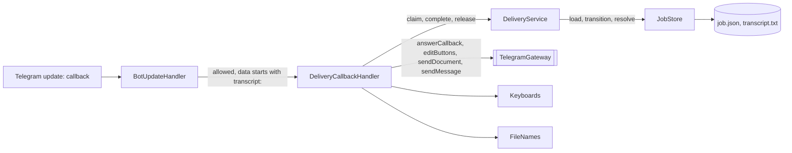

# T12 components

## What changes

| Component | Change | Why there |
|---|---|---|
| `job/DeliveryService` (new) | The state side of a button tap: `claim(jobId, userId, kind)` checks owner, state and expiry and moves the file `AVAILABLE` → `SENDING` (one winner per race); `complete(...)` moves `SENDING` → `SENT`; `release(...)` moves `SENDING` → `AVAILABLE`. Knows nothing about Telegram. Works for both `FileKind`s, so T13 reuses it unchanged. | The one-send rule needs `JobStore.transition` (per-job lock). `job/` stays free of `bot/`, as in T11. |
| `bot/DeliveryCallbackHandler` (new; public class and constructor, package-private `handle`) | Takes a `transcript:<jobId>` tap: calls `claim`, answers the tap, shows "Sending transcript…" on the summary message, sends `<title>.txt` with `sendDocument`, then `complete` and "Transcript sent". On a send error: `release`, restore the button, tell the user. Maps every refusal to a short notice. | The Telegram side of the flow. T13 adds the `audio:` branch here. |
| `bot/FileNames` (new, package-private, static) | `transcriptName(title)`: `<title>.txt` made safe for a file name. Pure. | Unit tests; one place for the rule. |
| `bot/Keyboards` | New `delivery(jobId, FileState audio, FileState transcript)`: the label of each button follows its file state. `delivery(jobId)` stays and means both `AVAILABLE`. Callback data never changes. | The summary message must show the state of each file; T13 reuses it. |
| `bot/TelegramGateway` + `TelegramClientGateway` | New `editButtons(chatId, messageId, buttons)` (Bot API `editMessageReplyMarkup`). | `editMessage` needs the message text, and `job.json` does not keep the summary text. Changing only the buttons is exact and cannot damage the text. |
| `bot/BotUpdateHandler` | Constructor takes a `DeliveryCallbackHandler`. A callback from an allowed user whose data starts with `Keyboards.TRANSCRIPT_PREFIX` goes to `DeliveryCallbackHandler.handle(callback)`. `audio:` stays ignored until T13. | Today the tap is dropped. |
| `config/PipelineConfig` | Beans `DeliveryService` and `DeliveryCallbackHandler`. | Needs the gateway, so it exists only with the bot. |
| `config/TelegramConfig` | `botUpdateHandler(...)` takes the `DeliveryCallbackHandler`. | Wiring. |
| `job/JobStore`, `JobRecord`, `JobFile`, `FileState` | No change. `transition`, `load`, `resolve` are used as they are. | |
| `UrlMessageHandler`, `PipelineService`, `SummaryMessagePublisher`, media, transcript, summary | No change. | |

Not changed and out of scope: the audio button and `AudioPreparer` (T13), the sweeper, the buttons "expired" text and the restart recovery of `SENDING` (T14), access control.

## Diagram

