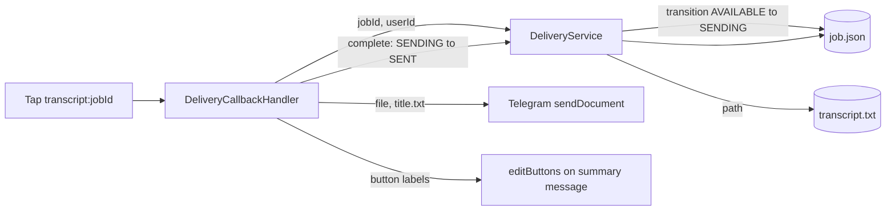

# T12 data flow

| From → to | Data | Format / where stored |
|---|---|---|
| Telegram → `BotUpdateHandler` | callback query: id, `from.id`, `data`, message (private chat) | Telegram `Update` |
| `BotUpdateHandler` → `DeliveryCallbackHandler` | the `CallbackQuery` | in memory |
| `DeliveryCallbackHandler` → `DeliveryService` | `jobId` (from `data` after `transcript:`), tapping user id, `FileKind.TRANSCRIPT` | in memory |
| `DeliveryService` ↔ `JobStore` | `JobRecord` read; file state change `AVAILABLE→SENDING→SENT` (or back to `AVAILABLE`) | `<work-dir>/<jobId>/job.json`, written atomically under the job lock; `sentAt` is set on `SENT` |
| `DeliveryService` → handler | `Claim(outcome, job, file)`; `file` = `<work-dir>/<jobId>/transcript.txt` | in memory |
| handler → Telegram | `answerCallback` (text), `editButtons` (one row), `sendDocument(chatId = job.chatId, file, "<title>.txt", caption null)`, on failure `sendMessage` | Bot API |

Stored state: only `job.json` changes (`files.TRANSCRIPT.state`, `files.TRANSCRIPT.sentAt`). `transcript.txt` is read, never changed or deleted by T12 (T14 deletes it). The job id from the button is checked by `JobStore.directory` (`[A-Za-z0-9_-]{1,40}`); an invalid id is treated as an unknown job.

