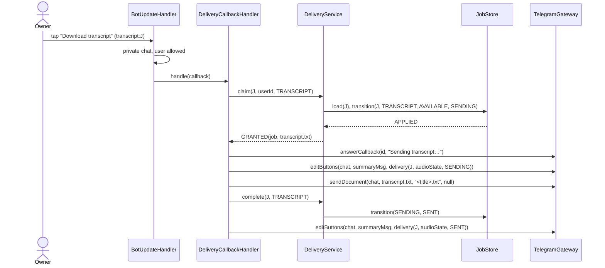
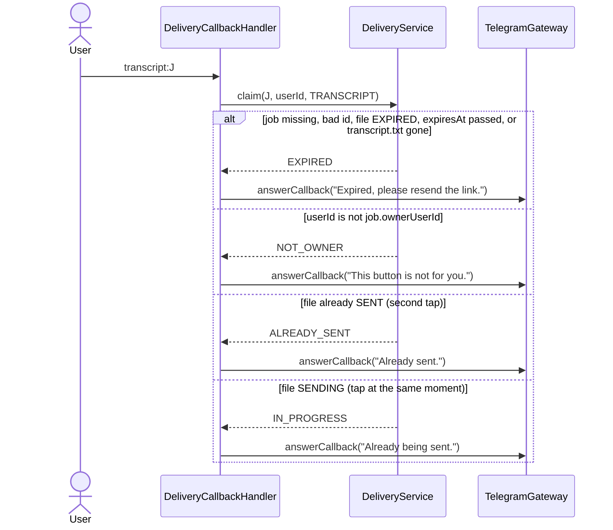
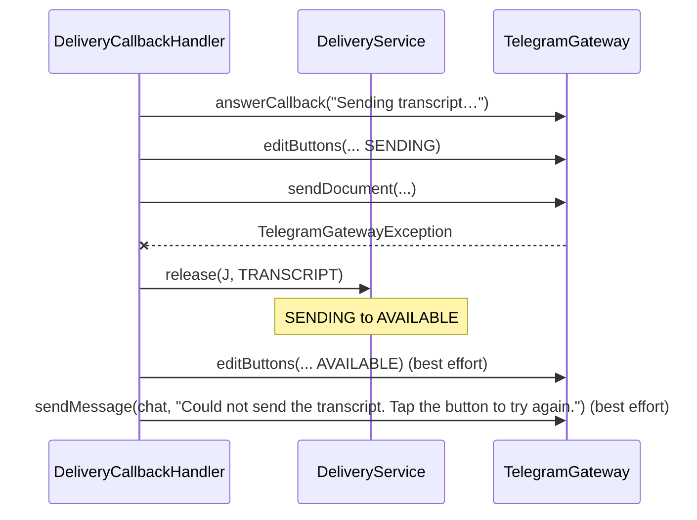
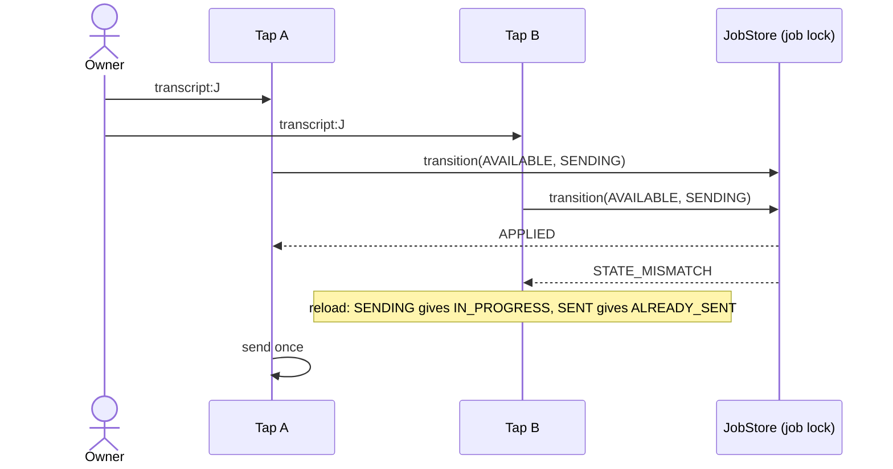

# T12 flows

Thread: `BotUpdateHandler` runs on the Telegram consumer thread. Two taps may run at once only if the consumer is multi-threaded; `JobStore` makes this safe either way (F4).

## F1: success

The audio button is rendered from the audio file's current state (read from the record returned by `claim`/`complete`), so it stays "Download audio" while that file is `AVAILABLE`.

## F2: refusals (no state change, no file sent)

Check order inside `claim`: job missing → `EXPIRED`; owner mismatch → `NOT_OWNER`; file `SENT` → `ALREADY_SENT`; file `EXPIRED` → `EXPIRED`; file `SENDING` → `IN_PROGRESS`; file `AVAILABLE` and `expiresAt` not after now → `EXPIRED`; file `AVAILABLE` but `transcript.txt` not on disk → `EXPIRED` (file marked `EXPIRED`, nothing uploaded); else try the transition.

## F3: failure while sending

The same path runs when any `RuntimeException` is thrown after the claim (`IOException` is never thrown, `sendDocument` reads the file inside the gateway call). A failure of an `editButtons` call (for example "message is not modified" or a deleted message) is logged and ignored: the state in `job.json` is the truth and the document is still sent. If `complete` fails after a successful send, the error is logged; the file stays `SENDING` (T14 recovery will reset it).

## F4: two taps at the same moment

## F5: unknown or unusable job

A tap on `transcript:` with an empty or invalid id, or a job whose `job.json` is missing or corrupt, gives `EXPIRED` (F2). A `JobStoreException` (an I/O error) is caught by the handler: `answerCallback("Something went wrong, please try again.")`, no state change.

## Not in this task

Access: a callback from a user who is not allowed is answered "No access." by `BotUpdateHandler` before `DeliveryCallbackHandler` runs (T4 behaviour, unchanged). Taps on `audio:` are ignored until T13.
