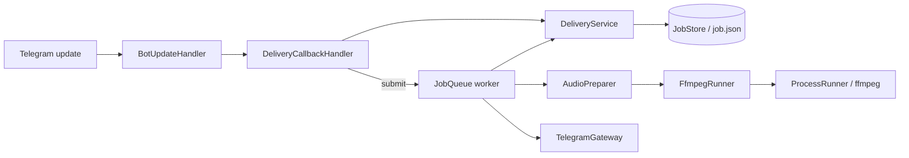

# T13 components

## Changes

| Component | Change | Why there |
|---|---|---|
| `media/AudioPreparer` (new) | The compression rule. Pure decision plus calls to `FfmpegRunner`; knows no Telegram and no job state. | One place for the rule, unit-testable with a stubbed `ProcessRunner`. |
| `media/PreparedAudio` (new) | Result record: file, mode, bitrate. | The handler builds the caption from it. |
| `media/FfmpegRunner` | Adds `encodeM4a(source, target, kbps, mono)`. | All ffmpeg calls live here. |
| `bot/DeliveryCallbackHandler` | Dispatches `audio:` taps. The state part is shared with the transcript tap; the audio part queues prepare + send on `JobQueue`. | Same one-send rules as T12. |
| `bot/TelegramGateway.sendAudio` | Signature gains `fileName` and `caption`. | The compression note travels with the audio (one message). |
| `bot/FileNames` | Adds `audioName(title, extension)`; shares the sanitising of `transcriptName`. | Same rules for file names. |
| `bot/BotUpdateHandler` | `data.startsWith(Keyboards.AUDIO_PREFIX)` → `delivery.handle(callback)`. | Same access checks as the transcript tap. |
| `config/MediaConfig`, `config/TelegramConfig` | Bean `AudioPreparer`; `DeliveryCallbackHandler` gets `AudioPreparer` and `JobQueue`. | Wiring. |
| `job/DeliveryService`, `job/JobStore`, `job/JobQueue` | Unchanged. `claim/complete/release(…, FileKind.AUDIO)` already work. | |
| `Keyboards` | Unchanged (audio labels exist since T12). | |

No new configuration property, no change of the `job.json` format.

