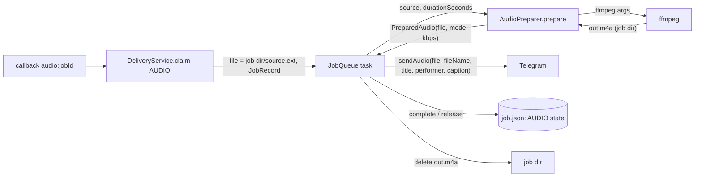

# T13 data flow

- Input: the source file named by `job.files.AUDIO.path` (`source.m4a`, `source.mp3`, `source.webm`, `source.mp4` …) and `job.durationSeconds` (from yt-dlp metadata; there is no ffprobe call).
- Output file: `<jobdir>/out.m4a`, only for the CONVERTED and COMPRESSED modes. It is deleted after the send attempt (success or failure). The source is never modified or deleted. The UNCHANGED mode returns the very same `Path` object as the source and nothing is written.
- `job.json`: only `files.AUDIO.state` and `sentAt` change (`AVAILABLE → SENDING → SENT`, or back to `AVAILABLE`). The `AUDIO.path` stays the source name.
- Telegram: `POST sendAudio` multipart: `chat_id`, `audio` (file with `fileName`), `title`, `performer`, `caption` (+ `parse_mode=HTML`).
