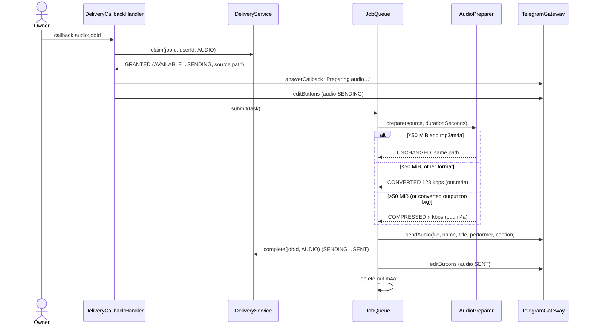
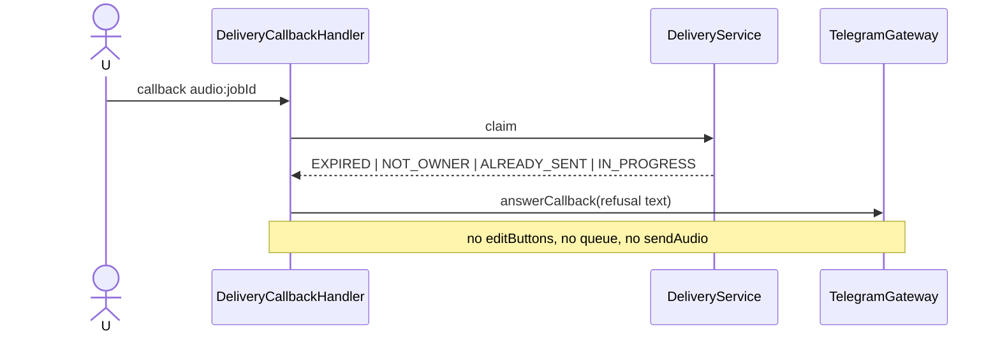
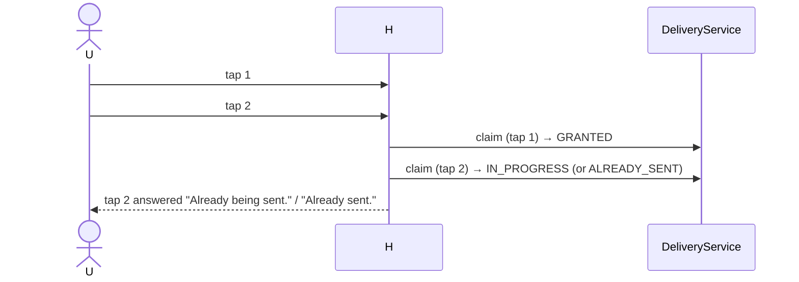

# T13 flows

## Main: unchanged / converted / compressed



## Refused tap (expired, not owner, already sent, in progress)



## Failure: ffmpeg fails, output too big after the retry, Telegram refuses

```mermaid
sequenceDiagram
  participant Q as JobQueue task
  participant P as AudioPreparer
  participant D as DeliveryService
  participant G as TelegramGateway
  Q->>P: prepare
  P--xQ: JobFailure FAILED/TIMEOUT (or sendAudio throws)
  Q->>D: release(AUDIO) (SENDING→AVAILABLE)
  Q->>G: editButtons (audio AVAILABLE)
  Q->>G: sendMessage "Could not send the audio. Tap the button to try again."
  Note over Q: delete out.m4a; job and transcript untouched; the user may tap again
```

## Concurrent taps: two taps, one send



## Expiry while queued

```mermaid
sequenceDiagram
  participant H
  participant Q as JobQueue
  participant D as DeliveryService
  H->>D: claim at 12:59 (expiresAt 13:00) → GRANTED
  H->>Q: submit (waits behind a summary job)
  Note over Q: runs at 13:05: the claim already holds the file, the send completes
  Q->>D: complete → SENT
  Note over D: a repeat tap on this claimed file gets Already being sent. / Already sent. (state precedes expiry); only a new AVAILABLE claim after 13:00 gets EXPIRED
```
