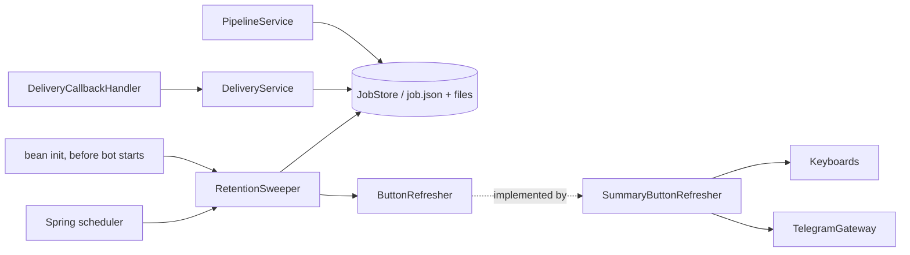

# T14 components

## Changes

| Component | Change | Why there |
|---|---|---|
| `job/RetentionSweeper` (new) | The retention rules. `recoverAtStartup()` (once, before the bot gets updates), `sweep()` (`@Scheduled`, every `app.jobs.sweep-interval`). Walks `JobStore.jobIds()`, calls the two store operations below per job, then asks `ButtonRefresher` to update buttons. Never throws; a failure of one job is logged and the next job is still handled. | One place for "when is a file or directory reclaimed". Knows no Telegram. Unit-testable with a fake `Clock` and a temp directory (`RetentionSweeperTest`). |
| `job/JobStore` | Adds `recover(jobId)` and `sweep(jobId, now, atStartup)`. Both run under the job's lock, so a tap (`transition`) and the sweeper never interleave. `discard` deletes `job.json` last. | The lock, `read` and `save` are private to the store; the sweeper must check `SENDING` and delete atomically. |
| `job/ButtonRefresher` (new interface) | `void refresh(JobRecord job)`: best effort, never throws. | Keeps `job/` free of `bot/` imports, like `SummaryPublisher`. |
| `bot/SummaryButtonRefresher` (new) | Implements `ButtonRefresher` with `TelegramGateway.editButtons` and `Keyboards.delivery(jobId, audio, transcript)`. | T12 labels already exist in `Keyboards`; no new label. |
| `config/JobConfig` | Bean `RetentionSweeper` (`initMethod = "recoverAtStartup"`), `@EnableScheduling`. `ButtonRefresher` comes from `ObjectProvider.getIfAvailable(() -> job -> {})`, so the sweeper also exists when Telegram is disabled. | Wiring. |
| `config/TelegramConfig` | `telegramBot` bean gets `@DependsOn("retentionSweeper")`. | Recovery must finish before long polling can start (see `api.md`, startup ordering). |
| `config/PipelineConfig` | Bean `ButtonRefresher summaryButtonRefresher(TelegramGateway)`. | Needs the gateway, so it lives with the bot. |
| `config/AppProperties.Jobs` | New last component `Duration sweepInterval`. | Lets `ExpiryIT` use a short interval. |
| `application.yml` | `app.jobs.sweep-interval: ${JOB_SWEEP_INTERVAL:PT1M}` | |
| `job/PipelineService`, `job/DeliveryService`, `bot/DeliveryCallbackHandler`, `Keyboards`, `FileState` | Unchanged. | Failed jobs are already discarded at once by `PipelineService`. A tap after removal already answers "expired" (`claim` → `EXPIRED` when the job is gone). |

No change of the `job.json` format.

## Lifecycle of a job (answer to Q-analyst-1)

No new persisted status. The state is read from the disk:

| On disk | Meaning | Runtime sweep | Startup |
|---|---|---|---|
| Directory, no usable `job.json` | PROCESSING (or an orphan left by a crash) | untouched | directory removed |
| `job.json` with `expiresAt == null` | between `store.create` and `published()` in `PipelineService`, or a crash there | untouched | directory removed |
| `job.json` with `expiresAt` set | DONE (published, retention running) | rules below | `SENDING` reset, then the same rules |
| no directory | FAILED (`PipelineService` discards at once) or finished | nothing | nothing |

## Sweep rules for one job (under the job lock)

1. No usable `job.json`: at runtime do nothing; at startup remove the directory (`recover`).
2. Any file `SENDING`: do nothing at all (R4). At startup `recover` has already reset it.
3. Each `AVAILABLE` file whose `expiresAt` is not null and `now >= expiresAt` (at startup also a null `expiresAt`): delete the file from disk, set `EXPIRED`.
4. If every file is `SENT` or `EXPIRED`, remove the directory. (A job record always has two files, so an empty map cannot occur after `published`; the rule still requires a non-empty map.)
5. Otherwise save `job.json` if rule 3 changed anything.
6. If rule 3 expired at least one file and `summaryMessageId != null`: `ButtonRefresher.refresh(job after)`, after the lock is released and also when the directory was removed. `SENT` files keep the "sent" label because the label follows the stored state.
