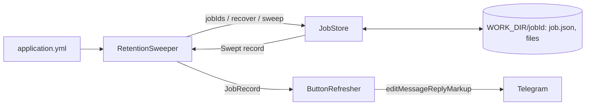

# T14 data flow

| Data | From → to | Format | Stored |
|---|---|---|---|
| `jobIds()` | `JobStore` → `RetentionSweeper` | `List<String>` of directory names matching `[A-Za-z0-9_-]{1,40}`. Other names under `WORK_DIR` are never touched. | |
| `Recovered` / `Swept` | `JobStore` → `RetentionSweeper` | records, see `api.md`. The `JobRecord` they carry is the state after the change and is read again nowhere. | |
| Job record after expiry | `RetentionSweeper` → `ButtonRefresher` | `JobRecord` (needs `chatId`, `summaryMessageId`, `jobId`, file states) | not persisted |
| Keyboard edit | `SummaryButtonRefresher` → Telegram | `editMessageReplyMarkup` with one row: `audio:<jobId>`, `transcript:<jobId>`; labels from `Keyboards` | |
| File state change | `JobStore.sweep` → disk | file deleted, then `job.json` rewritten atomically (`AtomicFiles`), or directory removed (`job.json` last) | `WORK_DIR/<jobId>/` |
| Interval | `application.yml` → `@Scheduled` | ISO-8601 duration, default `PT1M` | env `JOB_SWEEP_INTERVAL` |

Order inside `sweep`: file removal first, `job.json` save second. A crash between them leaves `AVAILABLE` with a missing file; `DeliveryService.claim` already turns that into `EXPIRED` and the next sweep expires it. Order inside directory removal: everything except `job.json`, then `job.json`. A failure in the middle leaves `job.json` present, so the next pass retries.

