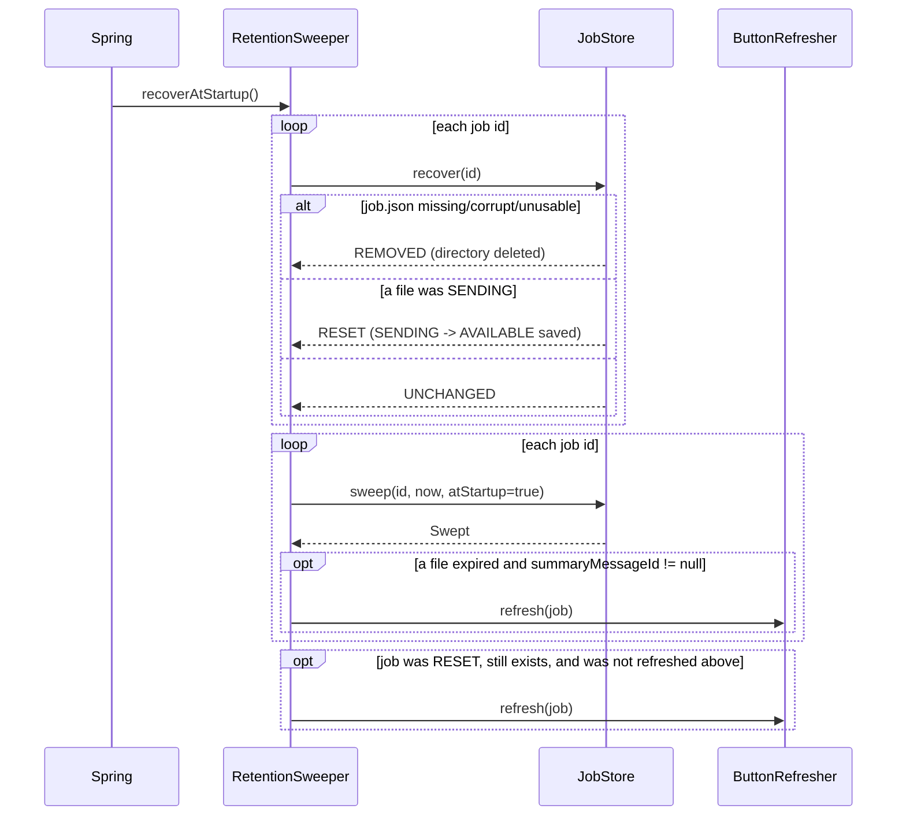
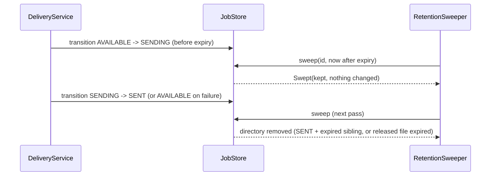
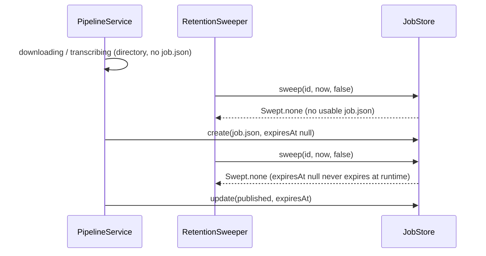

# T14 flows

## 1. Startup (recover, then first sweep)

Runs in the init method of the `RetentionSweeper` bean. `telegramBot` is declared `@DependsOn("retentionSweeper")` and the starter's `TelegramBotInitializer` registers bots only after it has the `telegramBot` bean, so polling cannot start before this returns (contract in `api.md`). The `JobQueue` is empty, so no tap and no pipeline can run during it. The first scheduled run is one interval later.



## 2. Scheduled sweep, expired files (idle bot)

```mermaid
sequenceDiagram
  participant Sch as Spring scheduler
  participant RS as RetentionSweeper
  participant JS as JobStore
  participant BR as ButtonRefresher
  participant TG as Telegram
  Sch->>RS: sweep()
  loop each job id
    RS->>JS: sweep(id, now, false)
    Note over JS: lock; read; no SENDING;<br/>delete expired AVAILABLE files; EXPIRED;<br/>all SENT/EXPIRED -> remove directory
    JS-->>RS: Swept(job, newlyExpired, removed)
    opt newlyExpired non-empty and summaryMessageId != null
      RS->>BR: refresh(job)
      BR->>TG: editMessageReplyMarkup (best effort)
    end
  end
```

## 3. Sweep meets a send in progress



If the sweep wins the lock first, the later `claim` finds `EXPIRED` or no job and answers "Expired, please resend the link." with no upload.

## 4. Live processing is left alone



## 5. Failure flows

```mermaid
sequenceDiagram
  participant RS as RetentionSweeper
  participant JS as JobStore
  participant BR as ButtonRefresher
  RS->>JS: sweep(job A)
  JS--xRS: JobStoreException (I/O)
  Note over RS: log id + exception, no path to users; go on
  RS->>JS: sweep(job B)
  JS-->>RS: Swept
  RS->>BR: refresh(B)
  BR--xBR: TelegramGatewayException (HTTP 400)
  Note over BR: logged inside the refresher; files stay expired
  Note over RS,JS: next pass retries A (state on disk stays consistent)
```

## 6. Tap after removal

`DeliveryCallbackHandler` → `DeliveryService.claim` → `store.load` empty → `Outcome.EXPIRED` → "Expired, please resend the link." Unchanged from T12.
