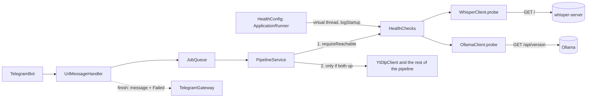

# T16 components

## Changes

| Component | Change | Why there |
|---|---|---|
| `job/HealthChecks` (new) | Probes Whisper and Ollama in parallel with one short timeout. `check()` returns both results, `logStartup()` logs one line per service, `requireReachable()` throws `JobFailure` when a service is down. Never throws anything else for an unreachable service. | One place for "is the service up". `job/` already depends on `transcript/` and `summary/`, and the check is part of the job pipeline. Unit-testable with fake `ServiceProbe`s (`HealthChecksTest`). |
| `job/ServiceProbe` (new interface), `job/ProbeResult` (new record), `job/Health` (new record) | The seam between `HealthChecks` and the two HTTP clients. | Lets `HealthChecks` be tested without a network and keeps it free of HTTP code. |
| `transcript/WhisperClient` | New method `ProbeResult probe(Duration timeout)`: `GET <base-url>/`. Any HTTP response is "reachable". | Owns the URL and the HTTP transport. |
| `summary/OllamaClient` | New method `ProbeResult probe(Duration timeout)`: `GET <base-url>/api/version`. Any HTTP response is "reachable". | Same. |
| `job/JobFailure` | New factory `unreachable(boolean whisperDown, boolean ollamaDown)`. No new `Kind`, no new message text. | Reuses the T9/T10 texts; only the "both down" combination is new. |
| `job/PipelineService` | `execute` calls `health.requireReachable()` as its first statement, before `Files.createDirectories` and before `progress.downloading()`. Constructor gains `HealthChecks`. | The pipeline start is the one point every job passes, after queueing and before any download. It runs on the job worker, so the Telegram polling thread is never blocked (see below). The existing `run` catch block already discards the (not yet created) directory and rethrows the `JobFailure`; `UrlMessageHandler.finish` already tells the user and edits the status to `Failed.`. |
| `config/HealthConfig` (new) | Beans `HealthChecks` and an `ApplicationRunner` that starts `logStartup()` on a virtual thread. Not conditional on Telegram. | Wiring. The runner runs after the context is refreshed and never delays startup. |
| `config/SummaryConfig` | The `llmClient` bean method returns `OllamaClient` (it is still an `LlmClient`). | `HealthConfig` needs `probe`. |
| `config/PipelineConfig` | `pipelineService` bean takes `HealthChecks`. | Wiring. |
| `config/AppProperties` | New last component `Health health` with `record Health(Duration timeout)`. | Lets ITs use a short timeout. |
| `application.yml` | `app.health.timeout: ${HEALTH_TIMEOUT:PT3S}` | |
| `docs/host-setup.md`, `docs/decisions.md` | Startup log lines, the setting, the decision D14. | |
| `bot/UrlMessageHandler`, `TelegramBot`, `BotUpdateHandler`, `TranscriptionClient`, `SummaryService`, `JobStore`, `JobQueue` | Unchanged. | Failures during a job keep the T9/T10 behaviour. |

## Why the per-job check runs on the worker, not in `UrlMessageHandler.handle`

`TelegramBot` is a `LongPollingSingleThreadUpdateConsumer`: `handle` runs on the one polling thread, so a probe there would hold every other user's messages and taps for up to the timeout. Running it first in `PipelineService.execute`:

- never blocks polling;
- probes just before the work starts, so a job that waited in the queue is not judged by an old result;
- reuses the existing failure path, with no second place that sends messages or removes directories;
- costs the single worker at most `app.health.timeout` per down job (the two probes run in parallel); a healthy check takes milliseconds.

Consequence the owner sees: the user first gets `Queued: position N` and then, within seconds, the unreachable message and `Failed.` on the status message. No download starts and no directory is created.

