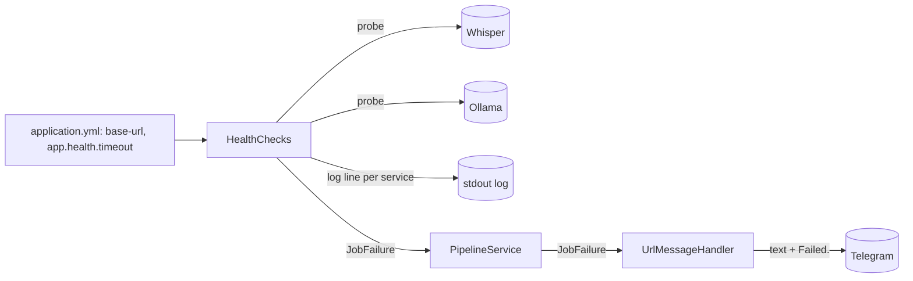

# T16 data flow

No new stored data: `job.json`, `allowed-users.json` and the job directory are unchanged. A failed check creates no directory.

| From → to | Data | Format | Stored |
|---|---|---|---|
| `HealthChecks` → `WhisperClient.probe` / `OllamaClient.probe` | timeout | `Duration` | no |
| probe → Whisper / Ollama | `GET /` or `GET /api/version`, no body, no credentials | HTTP | no |
| Whisper / Ollama → probe | status code only; the body is not read | HTTP | no |
| probe → `HealthChecks` | `ProbeResult(reachable, reason)` | Java record; `reason` is a fixed short phrase, never a URL | no |
| `HealthChecks` → log | one line per service | text, see `api.md` | log only |
| `HealthChecks` → `PipelineService` | nothing on success; `JobFailure` when a service is down | exception | no |
| `PipelineService` → `UrlMessageHandler` | `JobFailure` (existing path) | exception | no |
| `UrlMessageHandler` → Telegram | failure text (existing), then `Failed.` edit | Bot API | no |

