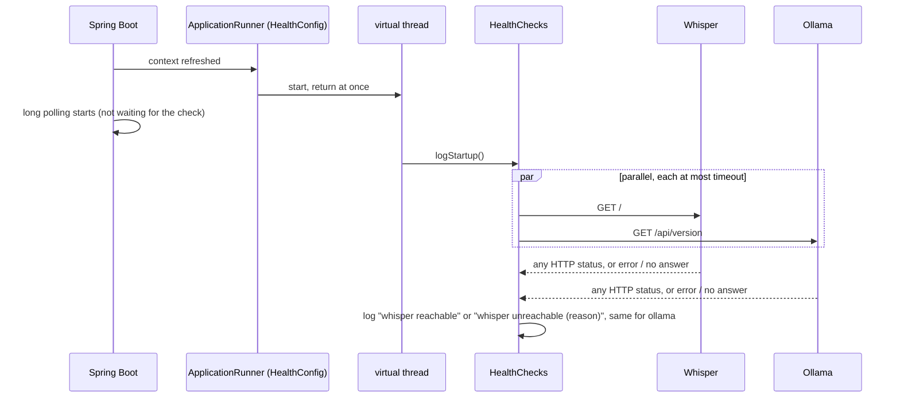
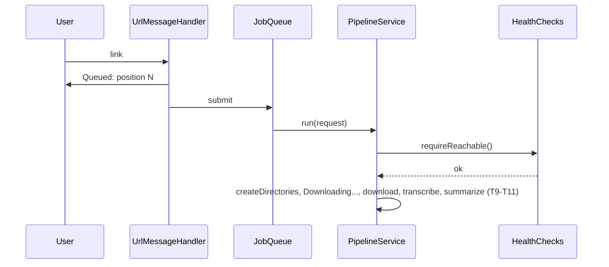
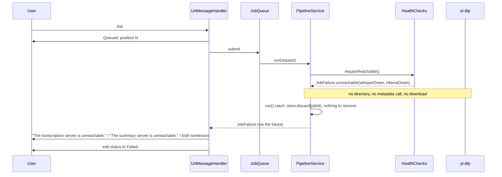

# T16 flows

## 1. Startup, both services up, or one or both down

The bot starts in every case. An exception in `logStartup` is caught and logged as one line.

## 2. Job, both services up (main flow, unchanged after the check)

## 3. Job, Whisper down, Ollama down, or both (failure)

Other users' messages and taps are handled meanwhile by the polling thread. Their jobs wait behind this one for at most `app.health.timeout`.

## 4. Service goes down mid-job

Unchanged (T9: `SERVICE_UNREACHABLE` after the chunk retry; T10: `SUMMARY_UNREACHABLE`). The directory is deleted by `PipelineService.run`.

## 5. Failures that need no new design (reached by existing flows)

| Case | Flow |
|---|---|
| Private, unsupported, too-long URL | existing: `UrlValidator` (before queueing) or `YtDlpClient` (T8/T11) |
| Callback from a non-allowlisted user | existing: `BotUpdateHandler` access gate (T4-T7) |
| Restart with pending access requests | existing: `AccessStore` reload (T5-T7) |

T16 adds tests for these only where `requirements.md` says an earlier task did not cover them; no code changes.
