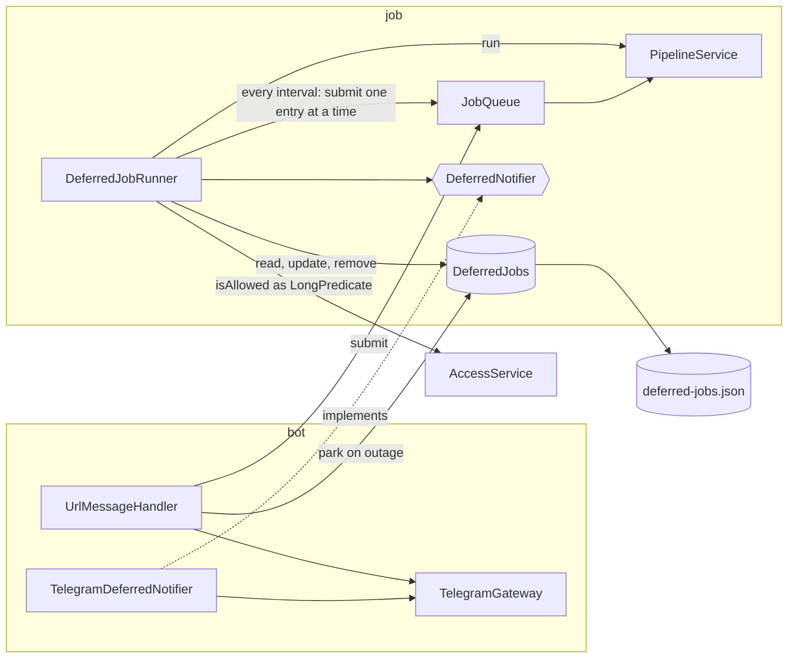

# T18 components

## What changes

| Component | Package | Change | Why there |
|---|---|---|---|
| `DeferredJobs` | `job/` | **new.** The queue of parked jobs: in-memory list, `deferred-jobs.json` persistence, corrupt-file handling. One lock. | Same shape as `AccessService` + `AccessStore`, in one class because the state is a plain list. |
| `DeferredJob` | `job/` | **new** record, one queue entry. | |
| `DeferredJobRunner` | `job/` | **new.** `@Scheduled` pass, retry of one entry through `PipelineService`, attempt accounting, final outcome. | Pure job logic, no Telegram. |
| `DeferredNotifier` | `job/` | **new** interface. Telegram side of the end of a retry (done, give-up, failure); a retry shows no progress. | Keeps `job/` free of `bot/` imports (D9). |
| `TelegramDeferredNotifier`, `DeferredMessages` | `bot/` | **new.** Implements `DeferredNotifier` with `TelegramGateway`; holds the fixed texts. | Keeps Telegram out of `job/`. |
| `UrlMessageHandler` | `bot/` | **changed.** On an outage failure it parks the job instead of reporting a failure, then edits the status message. | It is where the first run ends and the status message id is known. |
| `JobFailure` | `job/` | **changed.** Adds `isServiceOutage()`. | One definition of "outage". |
| `AppProperties` | `config/` | **changed.** New record `Deferred(retryInterval, maxAttempts)`. | |
| `PipelineConfig` | `config/` | **changed.** Beans `DeferredJobs`, `DeferredNotifier`, `DeferredJobRunner`; `UrlMessageHandler` gets `DeferredJobs`. | These need the Telegram gateway, so they live with the bot. |
| `application.yml`, `.env.example`, `docs/host-setup.md`, `SPEC.md` | | **changed.** New settings and criterion 14 / storage. | |

Unchanged: `PipelineService` (it already deletes the job directory on every failure, so nothing is left to park but the request, and it is the "normal pipeline" a retry runs), `JobQueue`, `JobStore`, `HealthChecks`, `AccessService`, `RetentionSweeper`. `JOB_RETENTION` is untouched: retention starts only when a summary is published, and a parked job has none.

## Decisions in short

- **Retry goes through the shared `JobQueue`**, so it is one at a time with user jobs (the local models are the bottleneck) and never overlaps another job.
- **The scheduler thread never waits for a job.** Spring's default scheduler has one thread, and a retry can last an hour, which would stop `RetentionSweeper`. A pass submits entry 1; its completion submits entry 2, and so on. User jobs that arrive meanwhile slot in between.
- **Access is a `LongPredicate`** (`accessService::isAllowed`), not an `AccessService` import into `job/`.
- **Outage means `SERVICE_UNREACHABLE` or `SUMMARY_UNREACHABLE`** (Whisper, Ollama, both), from the preflight or mid-job.
