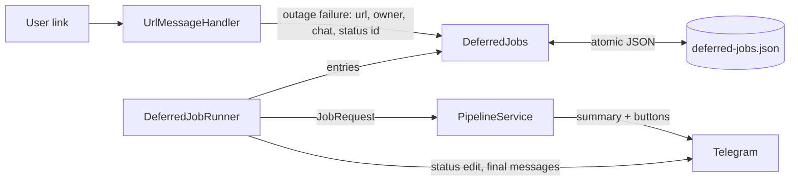

# T18 data flow

| From → to | Data | Format | Stored where |
|---|---|---|---|
| `UrlMessageHandler` → `DeferredJobs` | `JobRequest` (url, owner, chat), status message id | `DeferredJobs.park(request, statusMessageId)` | `deferred-jobs.json`, the sibling of `ACCESS_FILE` (default `/data/deferred-jobs.json`, next to `allowed-users.json`) |
| `DeferredJobs` → file | whole queue | JSON, pretty printed, atomic write (`AtomicFiles`, temp file + rename), `Json.MAPPER` | the data volume |
| `DeferredJobRunner` → `PipelineService` | new `JobRequest` (fresh job id, stored url/owner/chat, `createdAt = now`), a no-op `JobProgress` | Java call | job directory `WORK_DIR/<jobId>/`, deleted by the pipeline on failure |
| `DeferredJobRunner` → `AccessService` | owner user id | `LongPredicate` | `allowed-users.json` (read only) |
| `DeferredJobRunner` → `DeferredNotifier` | chat id, status message id, `JobFailure` | Java call | Telegram messages |

Only the URL and the owner data are stored. Working files of the first run are deleted at once by `PipelineService` (every failure deletes the job directory). A retry starts from scratch with a new job id.



## `deferred-jobs.json`

```json
{
  "jobs": [
    {
      "id": "3f2a…",
      "url": "https://www.youtube.com/watch?v=abc",
      "ownerUserId": 123456789,
      "chatId": 123456789,
      "statusMessageId": 42,
      "attempts": 0,
      "parkedAt": "2026-11-23T10:15:30Z"
    }
  ]
}
```

- `id`: the job id of the first run; it only identifies the entry (logs, removal). Every retry uses a new job id.
- `attempts`: retries that ended in an outage. 0 when parked.
- Order of `jobs` is the queue order (parking order) and is kept across restarts.
- Valid file: `jobs` may be missing or empty; every entry needs non-blank `id`, non-blank `url`, `ownerUserId != 0`, `chatId != 0`, `statusMessageId != 0`, `parkedAt != null`, `attempts >= 0`. Anything else (or invalid JSON, or trailing text) is "corrupt": the file is renamed to `deferred-jobs.json.corrupt-<epoch seconds>` and the queue starts empty.
- Contains user URLs: logs never print it (log the id and the attempt count only).
