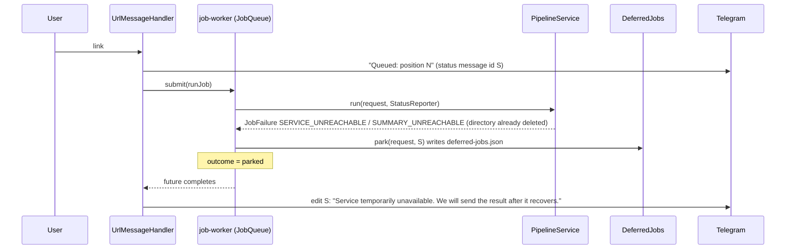
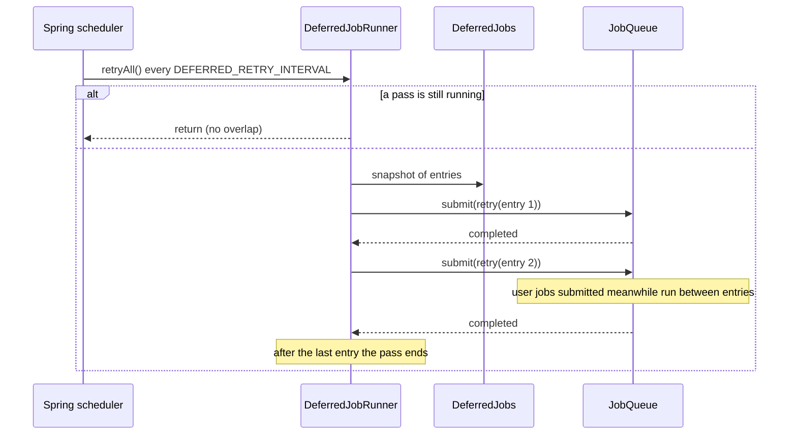
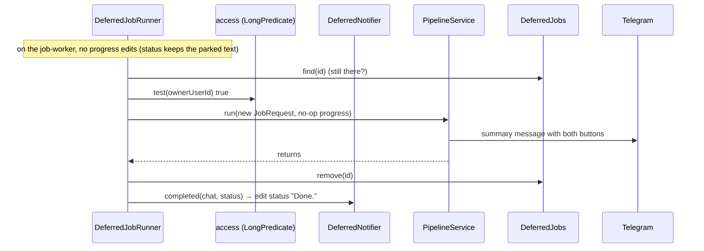
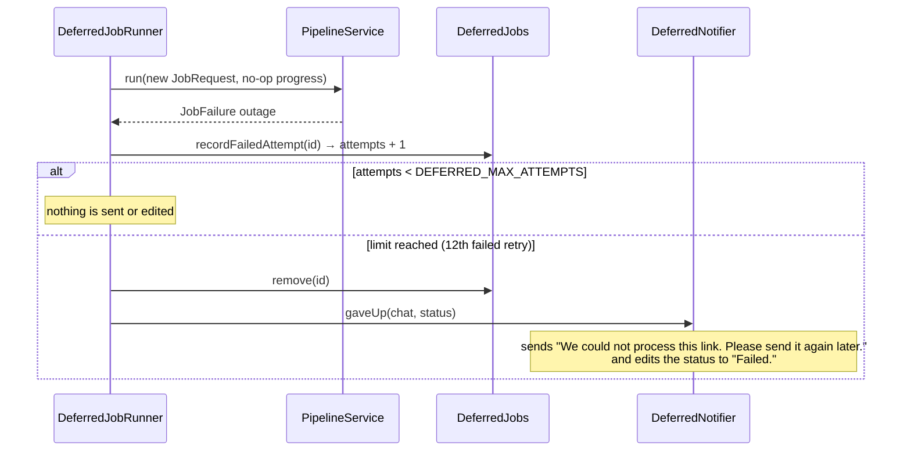
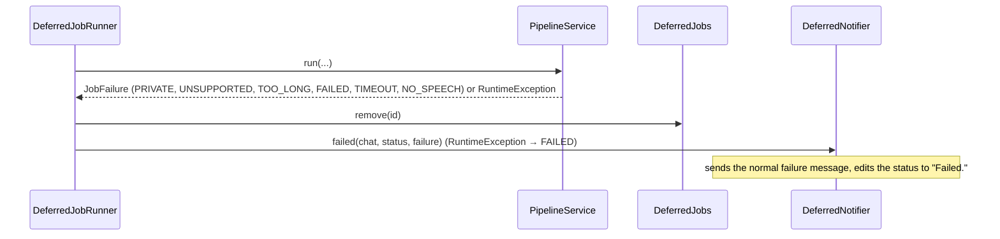
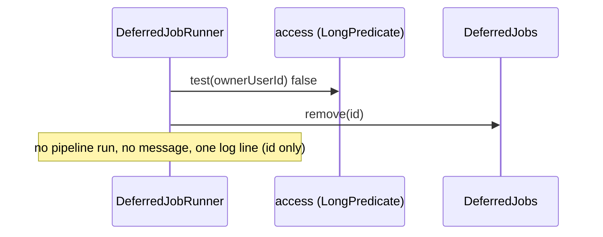

# T18 flows

## 1. Park: a service is down on the first run



No second message, no "Failed.". If `park` throws `DeferredJobsException`, the failure is reported the normal way (failure message + "Failed.") and logged.

## 2. Scheduled pass, entries run one at a time



The scheduler thread returns right after the first `submit`; later entries are submitted from the completion callback. If `submit` throws `RejectedExecutionException` (shutdown) the pass ends and entries stay.

## 3. Retry succeeds



## 4. Retry: service still down



## 5. Retry: any other failure closes the entry



## 6. User lost access while waiting



The check is made right before each retry, so access removed at any moment before the retry starts is honoured. The owner (`ADMIN_USER_ID`) always passes.

## 7. Restart

```mermaid
sequenceDiagram
  participant Spring
  participant DJ as DeferredJobs
  participant F as deferred-jobs.json
  participant DR as DeferredJobRunner
  Spring->>DJ: construct → load()
  alt file missing
    DJ-->>Spring: empty queue
  else valid
    DJ->>F: read; queue order and attempts kept
  else corrupt
    DJ->>F: rename to deferred-jobs.json.corrupt-<epoch s>; ERROR log; empty queue
  end
  Note over DR: first pass one full interval after start (initialDelay = interval), so a restart restarts the wait
```

## 8. Failures around the retry

- **Interrupted (shutdown):** if the worker thread is interrupted (`Thread.interrupted` / flag set, or the future is cancelled) when the retry ends with a failure, the entry is left as it was: no attempt counted, no message. The next start retries it.
- **Crash during a retry:** the entry is unchanged in the file, so the next start retries it. A crash after the summary was sent and before `remove` can send the summary twice; accepted.
- **Telegram fails** (edit, message, summary already sent): logged, dropped, never changes the entry. A failing summary publish inside the pipeline is a `FAILED` (flow 5).
- **`deferred-jobs.json` cannot be written** during `recordFailedAttempt` or `remove`: logged; the in-memory state is not changed (write first, then swap, as `AccessService`), so the entry will be seen again on the next pass. The retry outcome message is still sent. Consequences, accepted and not hidden:
  - `remove` fails after a successful retry: the summary was already sent, the entry stays, and the next pass sends the **summary a second time** (the same duplicate as a crash before `remove`). It repeats each pass until a write succeeds or the attempts run out.
  - `remove` fails after give-up or a non-outage failure: the user got the final message, and the next pass sends it again.
  - `recordFailedAttempt` fails: the count does not grow, so the entry can get more than `DEFERRED_MAX_ATTEMPTS` retries while the disk is unwritable.
  - `park` fails: nothing is promised; the user gets the normal failure message (flow 1).
- **Unexpected exception in a retry task:** caught in the task, logged, treated as flow 5 (entry closed with the `FAILED` message), so one entry never stops the pass.
