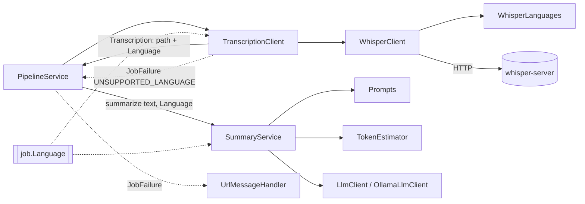

# T19 components

The language is decided once per job, by Whisper, on the first chunk that has text. It then travels with the job as a `Language` value: to Whisper (later chunks), to the summary (prompts, budget) and nowhere else. Bot texts, `job.json` and the buttons do not change.

## What changes

| Component | Change | Why there |
|---|---|---|
| `job/Language` (new enum `EN`, `RU`) | `code()` (`en`, `ru`), `displayName()` (`English`, `Russian`), `static Optional<Language> fromCode(String)` | `summary` and `transcript` both already depend on `job` (`JobFailure`), so the shared type lives there; no new dependency direction |
| `transcript/WhisperClient` | `transcribe(Path, String language)` returns `WhisperResult(text, language)`; sends `language`, `translate`, `detect_language`; on `auto` asks for `verbose_json` and reads `language` | the only class that talks to whisper-server |
| `transcript/WhisperLanguages` (new, package-private) | Whisper language name or code to ISO code | `verbose_json` returns full names, the refusal message needs a code |
| `transcript/TranscriptionClient` | detects on the first chunk with text, pins the rest, refuses other languages, returns `Transcription(Path transcript, Language language)` | it already owns the chunk loop and retry |
| `job/JobFailure` | `Kind.UNSUPPORTED_LANGUAGE`, factory `unsupportedLanguage(String code)` | fixed-message failure, travels the existing path |
| `summary/Prompts` | `Prompts.shortPrompt(Language)`, `mapPrompt`, `reduceFinalPrompt`, `reduceRoundPrompt` replace the four constants | prompts carry the language |
| `summary/TokenEstimator` | `charsPerToken(Language)`: EN 3, RU 2; every method takes the language | Cyrillic uses more tokens per character; otherwise a Russian chunk would overflow `num_ctx` and be truncated silently |
| `summary/SummaryService` | `summarize(String transcript, Language language)`; `maxChunkChars(Language)`, `partialMaxChars(Language)` | budget per language |
| `job/PipelineService` | passes the language from `Transcription` to `summarize` | the one place that joins the two stages |
| `docs/host-setup.md`, `SPEC.md` | `-l en` removed, contract section, English-only statements, manual check result | docs |

Unchanged on purpose: `OllamaLlmClient` and `LlmClient` (the language is in the system prompt), `SummaryFormatter` (1500 limit, bullets), `bot/*` (the refusal is a `JobFailure` and goes through `UrlMessageHandler.finish` like any failure), `FileNames` (it keeps Unicode, forbids only `\/:*?"<>|` and controls, cuts to 100 UTF-16 units: at most about 210 bytes in UTF-8 with the extension, under the 255-byte file-system limit; Tester checks one Cyrillic title), `DeferredJobRunner` and `UrlMessageHandler.runJob` (`isServiceOutage()` is false for the new kind, so no parking, and a retried entry that hits it ends with the normal error message).

