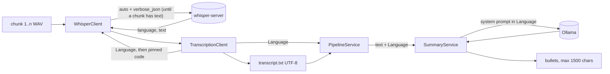

# T19 data flow

| Data | From to | Format | Stored |
|---|---|---|---|
| `language` field of the first Whisper request | `WhisperClient` to whisper-server | multipart text `auto` | no |
| `language` of the first answer | whisper-server to `WhisperClient` | JSON string, a full name (`russian`) or a code | no |
| selected `Language` | `TranscriptionClient` to `PipelineService` to `SummaryService` | enum | memory only, for the length of the job |
| `language` field of later requests | `WhisperClient` to whisper-server | multipart text `en` or `ru` | no |
| system prompt | `SummaryService` to Ollama | text built from `Language` | no |
| refusal | `TranscriptionClient` to `UrlMessageHandler` | `JobFailure(UNSUPPORTED_LANGUAGE)`, message with the code | no |

Nothing new is written to disk: `job.json` has no language field (the language is not needed after the summary), `transcript.txt` is plain UTF-8 text as before (Cyrillic is written and read with UTF-8 already). A deferred retry detects the language again.

