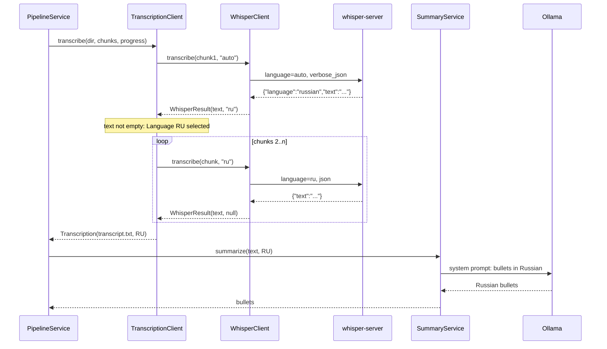
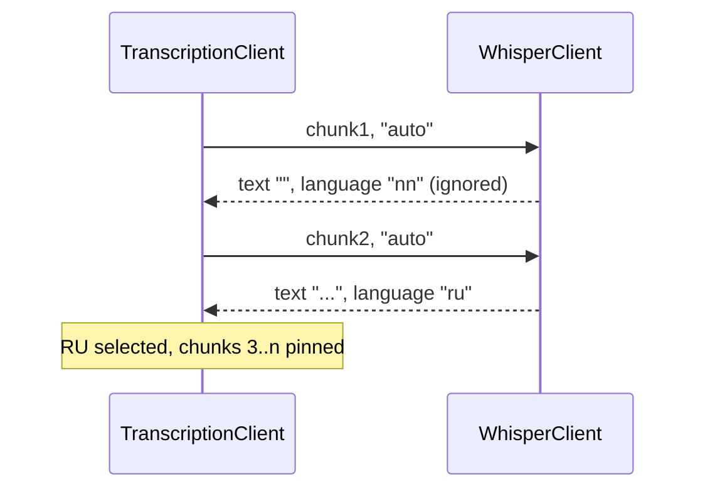

# T19 flows

## Main: Russian video



English video: the same with `en` and English prompts (unchanged text apart from the language name).

## Unsupported language (any code but en and ru)

```mermaid
sequenceDiagram
  participant H as UrlMessageHandler
  participant P as PipelineService
  participant T as TranscriptionClient
  participant W as WhisperClient
  H->>P: run(request, progress)
  P->>T: transcribe
  T->>W: transcribe(chunk1, "auto")
  W-->>T: WhisperResult(text, "de")
  T--xP: JobFailure UNSUPPORTED_LANGUAGE ("Only English and Russian videos are supported. Detected language: de.")
  Note over P: deletes the job directory, rethrows
  P--xH: JobFailure
  Note over H: isServiceOutage() false: no parking; status message edited with the failure text. No chunk 2, no Ollama call
```

## Silent start

Chunk 1 returns empty text (the language is then not trusted): `TranscriptionClient` sends chunk 2 with `auto` again, and so on. The first chunk with text selects or refuses. If no chunk has text: `JobFailure NO_SPEECH` as now.



## Failures

- Whisper fails on a chunk (any language mode): the existing retry, once per chunk, with the same language argument; then `SERVICE_UNREACHABLE` or `FAILED` as in T9. A retry of the first chunk sends `auto` again.
- The `auto` answer has text but `language` is missing, null, not a string or blank (a nonblank unknown value such as `klingon` is not this case: it is a refusal with code `unknown`): a `WhisperException` ("Whisper answer has no language"), so retry and then `FAILED` ("Transcription failed...").
- Ollama failures with a Russian prompt: unchanged (`SUMMARY_UNREACHABLE`, `TIMEOUT`, `FAILED`).
- Deferred retry (T18) of a job that was parked for an outage: starts from scratch, detects again; a refusal there ends the entry with the normal error text.
