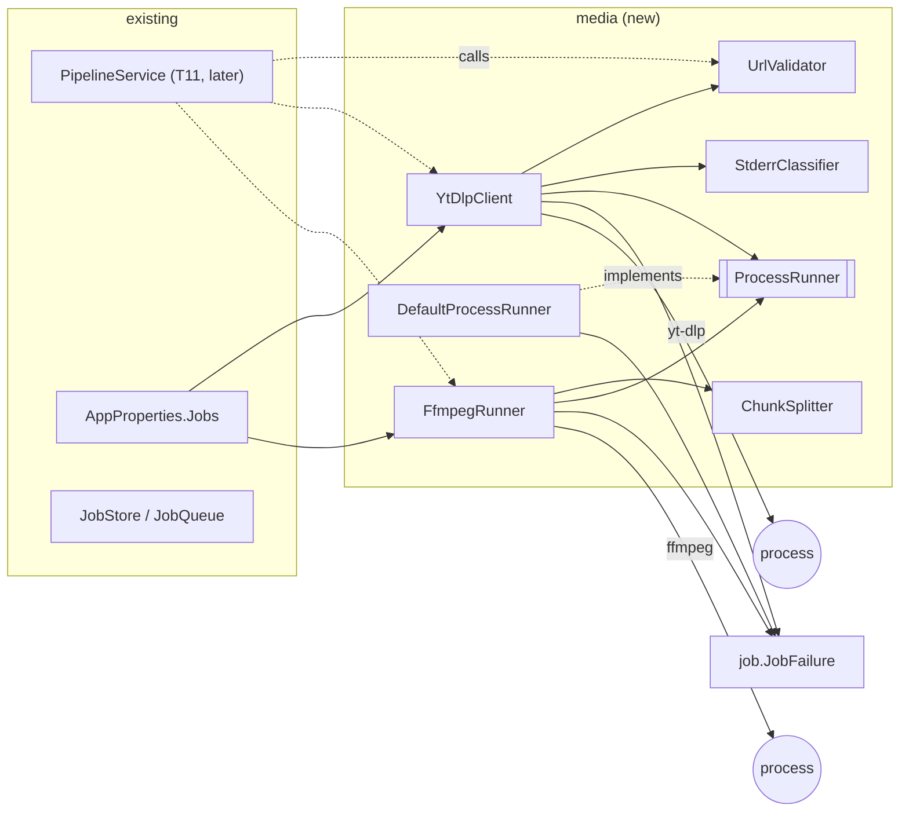

# T8 components

T8 adds the `media` package (external-process wrappers) and `job/JobFailure`. Nothing existing
changes behavior. `config/AppProperties.Jobs` gets three timeout fields, and `application.yml` the
matching keys. No bot, queue or store code is touched: T11 (`PipelineService`) will call the new
classes later, so T8 has no user-visible behavior.

| Component | Package | New / changed | Why there |
|---|---|---|---|
| `ProcessRunner` | `media` | new interface | The only seam to the OS. Tests and the later functional harness (SPEC: "fake `ProcessRunner`") replace it. |
| `DefaultProcessRunner` | `media` | new | Real implementation: `ProcessBuilder` with an argument list, captures output, timeout kills the process tree. |
| `ProcessResult` | `media` | new record | `exitCode`, `stdout`, `stderr`. |
| `UrlValidator` | `media` | new | Pure function on a string. Runs before any process starts. |
| `YtDlpClient` | `media` | new | Builds yt-dlp commands, parses metadata, enforces max duration, maps errors. |
| `StderrClassifier` | `media` | new (package-private) | The one table of stderr substrings to `Kind`. Used by `YtDlpClient`; one place to change. |
| `FfmpegRunner` | `media` | new | Makes the 16 kHz mono WAV and splits it, through `ProcessRunner`. |
| `ChunkSplitter` | `media` | new (package-private) | Pure part of splitting: builds the ffmpeg segment arguments and lists the produced chunk files in order. |
| `VideoMetadata` | `media` | new record | `title`, `duration`. |
| `JobFailure` | `job` | new | Unchecked exception with `Kind` and a user-safe message. |
| `MediaConfig` | `config` | new | Beans: `ProcessRunner`, `YtDlpClient`, `FfmpegRunner`, `UrlValidator`. |
| `AppProperties.Jobs` | `config` | changed | Adds `metadataTimeout`, `downloadTimeout`, `ffmpegTimeout`. |
| `application.yml` | resources | changed | Adds the three keys with env overrides. |

Out of scope: `AudioPreparer`, `encodeAacMono` and the 50 MB rule (T13). Transcription (T9).

Design notes:
- `YtDlpClient` calls `UrlValidator` itself, so no caller can reach `yt-dlp` with an unvalidated URL.
  The bot (T11) may call the validator earlier for a fast reply.
- Binaries are `yt-dlp` and `ffmpeg` from `PATH` (the container image installs them). Constants, not config.
- Chunk length (10 min) is a constant in `ChunkSplitter`, not config.
- The max duration reuses the existing `jobs.maxVideoDuration`.
