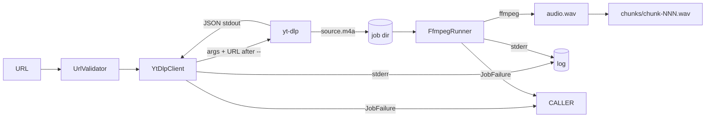

# T8 data flow

Nothing is stored in `job.json` by T8. Files are written under a job directory that the caller
passes in (`<WORK_DIR>/<jobId>/`, created by `JobStore`); T11 will record them.

| From | To | Data | Format |
|---|---|---|---|
| caller | `YtDlpClient` | video URL | `String`, validated by `UrlValidator` |
| `YtDlpClient` | `yt-dlp` | argument list, URL last after `--` | `List<String>`, no shell |
| `yt-dlp` | `YtDlpClient` | metadata | stdout, one JSON object (`--dump-single-json`): `_type` (absent for a video), `title` (string), `duration` (number, seconds, may be missing or null), `is_live` (bool, optional) |
| `yt-dlp` | job dir | audio | `<jobDir>/source.<ext>` (m4a preferred) |
| `YtDlpClient` | caller | `VideoMetadata(title, duration)`, then `Path` of the audio file | Java |
| caller | `FfmpegRunner` | source audio path, job dir | `Path` |
| `ffmpeg` | job dir | `<jobDir>/audio.wav` (16 kHz, mono, PCM s16le); chunks `<jobDir>/chunks/chunk-000.wav`, `chunk-001.wav`, ... | WAV |
| `FfmpegRunner` | caller | ordered `List<Path>` of chunks | Java |
| failures | caller | `JobFailure(kind, safeMessage)` | unchecked exception |
| `yt-dlp` / `ffmpeg` stderr | log | raw stderr, truncated to 2000 chars | SLF4J `warn`, never in `JobFailure.getMessage()` |

Config: `app.jobs.metadata-timeout`, `download-timeout`, `ffmpeg-timeout`, `max-video-duration`
(existing).

