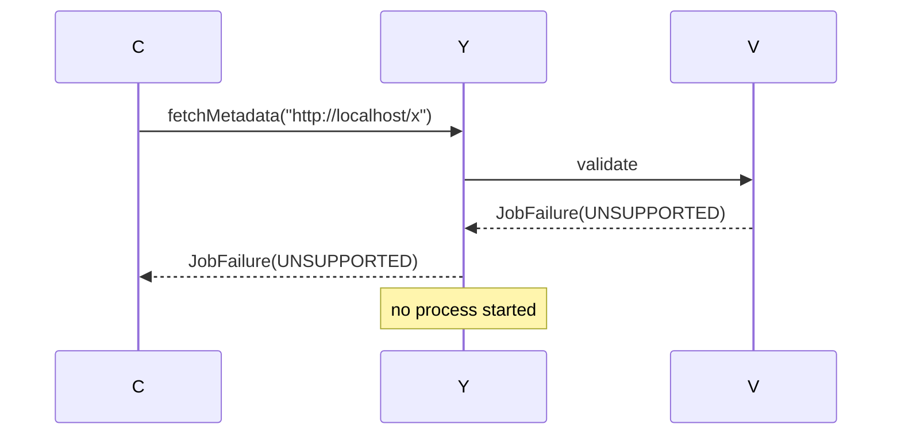
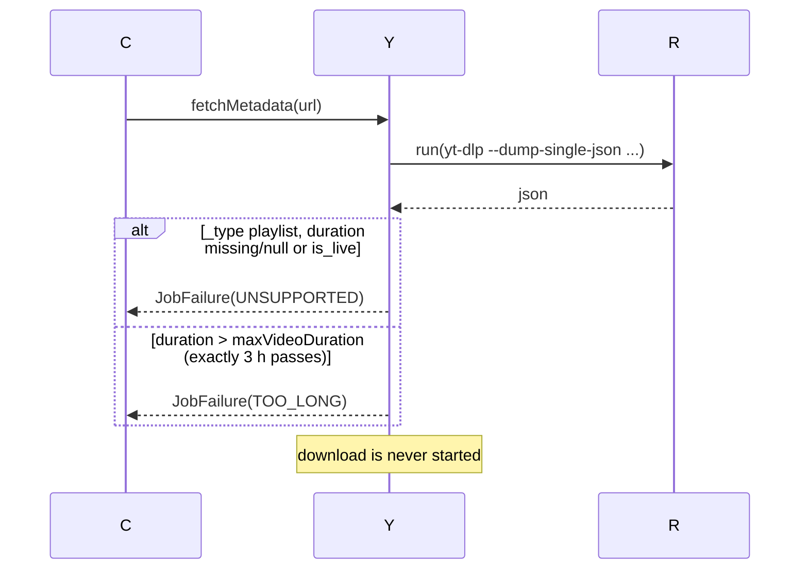
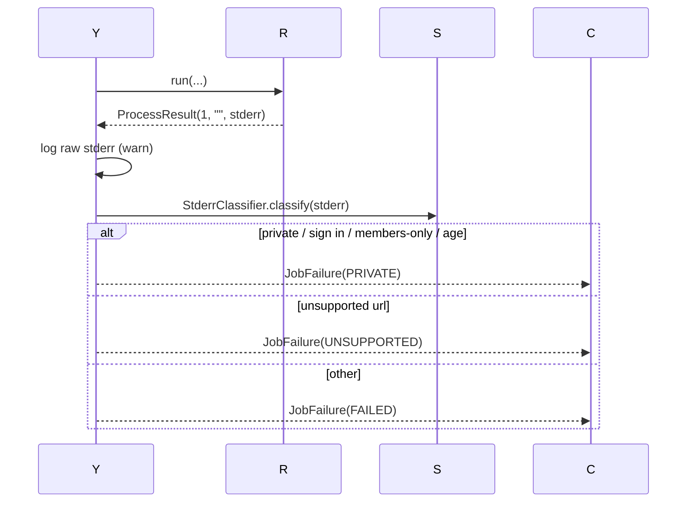

# T8 flows

## Main: metadata, download, WAV, chunks
```mermaid
sequenceDiagram
  participant C as Caller (T11)
  participant Y as YtDlpClient
  participant V as UrlValidator
  participant R as ProcessRunner
  participant F as FfmpegRunner
  C->>Y: fetchMetadata(url)
  Y->>V: validate(url)
  Y->>R: run(yt-dlp --dump-single-json ... -- url, metadataTimeout)
  R-->>Y: ProcessResult(0, json, "")
  Y->>Y: parse; not a playlist, duration present, not live, <= maxVideoDuration
  Y-->>C: VideoMetadata(title, duration)
  C->>Y: downloadAudio(url, jobDir)
  Y->>R: run(yt-dlp -f bestaudio[ext=m4a]/bestaudio -o jobDir/source.%(ext)s ... -- url, downloadTimeout)
  R-->>Y: ProcessResult(0, ...)
  Y-->>C: Path source.m4a
  C->>F: toWav(source, jobDir)
  F->>R: run(ffmpeg -i source -ar 16000 -ac 1 audio.wav, ffmpegTimeout)
  C->>F: split(wav, jobDir)
  F->>R: run(ffmpeg -i audio.wav -f segment -segment_time 600 -c copy chunks/chunk-%03d.wav, ffmpegTimeout)
  F-->>C: List<Path> chunks in order
```

## Invalid URL


## Too long / live stream


## yt-dlp non-zero exit


## Timeout
```mermaid
sequenceDiagram
  Y->>R: run(args, timeout)
  R->>P: start
  R->>R: wait(timeout) expires
  R->>P: destroyForcibly descendants, then process; wait up to 5 s
  R->>R: close streams, join readers (max 5 s)
  R-->>Y: JobFailure(TIMEOUT)
  Y-->>C: JobFailure(TIMEOUT) (unchanged)
```

## Parent exits, child keeps the pipes open
```mermaid
sequenceDiagram
  R->>P: start
  P-->>R: parent exits (code 0)
  R->>R: join readers, budget 5 s from parent exit
  R->>R: budget spent: close streams, readers end
  R-->>Y: ProcessResult(0, outputSoFar, errSoFar)
  Note over R: not a failure; orphan child not killed
```

## Stale output on retry
`downloadAudio` deletes `source.*` and `toWav` deletes `audio.wav` before starting, `split` empties `chunks/`. An exit 0 with no new file is therefore `FAILED`, never the old file.

## Process cannot start or ffmpeg fails
`DefaultProcessRunner` turns `IOException` on start (binary missing) into `JobFailure(FAILED)`.
A thread interrupt kills the process, restores the interrupt flag and gives `JobFailure(FAILED)`.
`FfmpegRunner` on a non-zero exit logs stderr and throws `JobFailure(FAILED)`; it also fails with
`FAILED` if no chunk file was produced.
