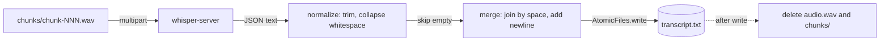

# T9 data flow

| From | To | Data | Format | Stored |
|---|---|---|---|---|
| `FfmpegRunner` (T8) | job dir | `chunks/chunk-NNN.wav`, 16 kHz mono pcm_s16le, about 10 min each | WAV | `<jobDir>/chunks/` |
| T11 | `TranscriptionClient` | `jobDir`, ordered chunk list, progress callback | Java args | none |
| `TranscriptionClient` | `WhisperClient` | one chunk path | `Path` | none |
| `WhisperClient` | `whisper-server` | `file`, `response_format=json`, `language=en`, `temperature=0.0` | `multipart/form-data` | none (chunk streamed from disk) |
| `whisper-server` | `WhisperClient` | `{"text": " ...\n ..."}` | JSON, UTF-8 | none |
| `WhisperClient` | `TranscriptionClient` | raw `text` | `String` | in memory, one per chunk |
| `TranscriptMerger` | `transcript.txt` | normalized chunks joined by one space, one trailing `\n` | UTF-8, no BOM, no header | `<jobDir>/transcript.txt`, `AtomicFiles.write` |
| `TranscriptionClient` | disk | delete `audio.wav`, files in `chunks/`, then `chunks/` | | `source.*`, `job.json` stay |

All chunk texts are held in memory until the merge (3 hours is about 18 chunks of a few KB each). The transcript is written only after every chunk succeeded and the result is not empty.

