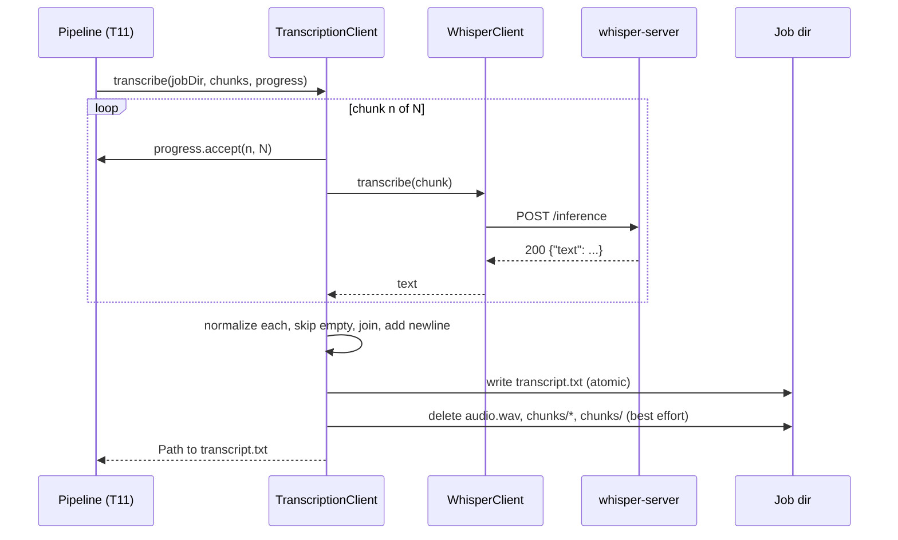
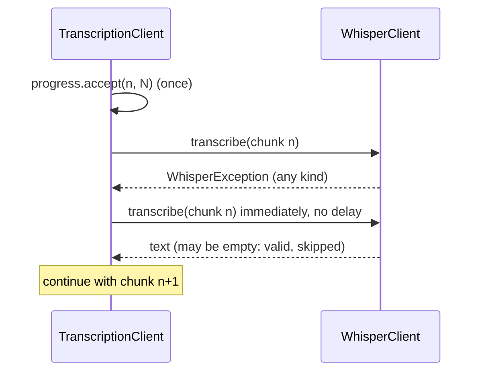
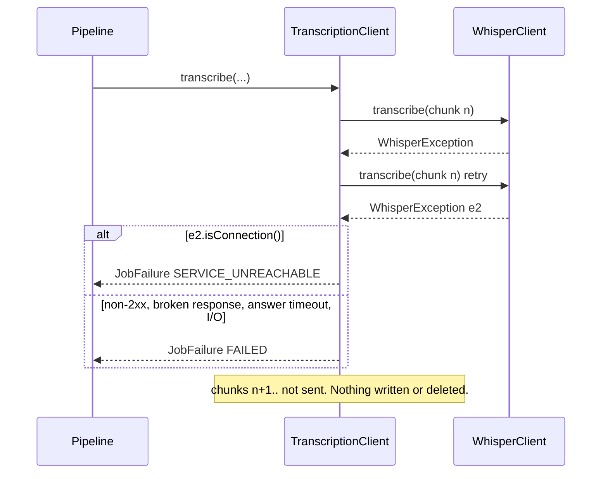
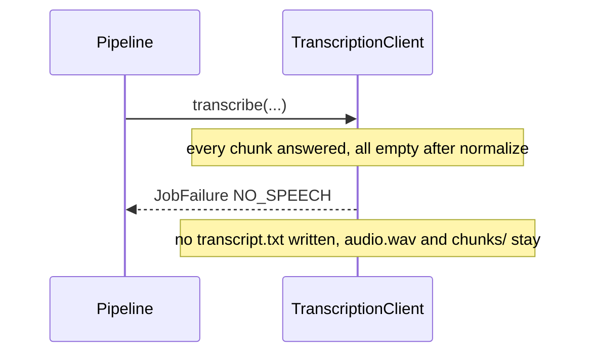

# T9 flows

## Main: all chunks succeed



## Retry: first attempt fails, second succeeds



## Failure: second attempt fails



Only the retry's failure decides the kind. Connection error then `400` gives `FAILED`; `400` then connection error gives `SERVICE_UNREACHABLE`.

## Failure: no speech



## Local I/O boundary (answer to Q-analyst-1)

```mermaid
sequenceDiagram
  participant TC as TranscriptionClient
  participant FS as Job dir
  TC->>FS: AtomicFiles.write(transcript.txt)
  alt write throws IOException
    TC-->>TC: JobFailure FAILED (transcriptionFailed, cause logged)
    Note over FS: nothing deleted; no partial transcript.txt (temp file + rename)
  else written
    TC->>FS: delete audio.wav (own try)
    TC->>FS: delete each chunk file (own try each), then chunks/ (own try)
    Note over TC,FS: a deletion error is logged WARN, the remaining deletions still run, result is still success
    TC-->>TC: return transcript path
  end
```

Rules:
- A transcript-write failure is `JobFailure(FAILED)` with the transcription message. Partial output: `AtomicFiles` writes a temp file and renames it, so `transcript.txt` is either the complete new text or untouched. T9 does not add rollback or its own cleanup of the temp file beyond what `AtomicFiles` does.
- Once the write succeeded the transcription is a success. A failure to delete any temporary file is logged at WARN (file name only, no content), does not stop the other deletions, does not change the result and is never rolled back. Deletions already done stay done. Leftovers are removed by the pipeline cleanup (T11, T14).
- Failures before the write (chunk failure, `NO_SPEECH`) delete nothing.

## Argument contracts (answer to Q-analyst-1)

| Input | Result |
|---|---|
| any argument `null` | `NullPointerException` (programming error, not a `JobFailure`) |
| `chunks` empty | `JobFailure(FAILED)`, no progress callback, nothing sent |
| `jobDir` is not an existing directory | `JobFailure(FAILED)`, nothing sent |
| a chunk path missing or unreadable | that chunk fails like any other attempt (`WhisperException`, not a connection error): retried once, then `FAILED` |
| `chunks` in a different order than `chunks/chunk-NNN.wav` | order of the list wins; T9 never lists the directory |
| chunk outside `<jobDir>/chunks/` | accepted as given; T9 does not validate locations (T8 produces the list) |
| `<jobDir>/transcript.txt` already exists | no replay or resume feature. A successful run replaces it atomically. A failed run (`NO_SPEECH`, chunk failure, write failure) leaves it untouched. T9 never reads it |
| `progress` throws | the exception propagates unchanged, nothing is written |
