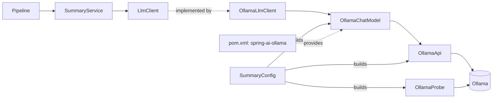

# TD13 components

Technical task: no new component. Three existing parts change.

| Part | Change | Why there |
|---|---|---|
| `pom.xml` | `spring-ai-starter-model-ollama` becomes `spring-ai-ollama` (version from `spring-ai-bom` 2.1.0). Add `org.springframework.boot:spring-boot-starter-jackson` (managed by Boot's BOM) **if** `dependency:tree` shows `tools.jackson.*` no longer resolves for `SummaryConfig`. | The starter brings 8 auto-configuration modules we exclude. `SummaryConfig` builds `OllamaApi` and `OllamaChatModel` itself. |
| `application.yml` | Remove the whole `spring.autoconfigure.exclude` block and its comment. | Nothing on the classpath to exclude. |
| `summary/OllamaLlmClient.failure()` | Remove the `InterruptedException` branch. | It sets the flag on the caller (job worker) for an exception raised in the call's own virtual thread. |

Unchanged: `SummaryConfig` (beans, STRICT_JSON, timeouts, `RetryTemplate`), `OllamaProbe`, `WhisperClient`, `callWithin`.

## Dependency impact (from the POMs in `~/.m2`, to be confirmed by `dependency:tree`)

- `spring-ai-ollama` 2.1.0 keeps: `spring-ai-model`, `spring-ai-retry`, `spring-webflux` (so `spring-web`, `RestClient`, `JdkClientHttpRequestFactory`), `spring-ai-systemone`, `jackson-databind` (2.x).
- Dropped with the starter: 8 `spring-ai-autoconfigure-*`, `spring-ai-client-chat`, `spring-boot-starter-restclient`, `spring-boot-starter-webclient` (reactor-netty, `spring-boot-reactor`).
- Risk 1: `SummaryConfig` imports `tools.jackson.*` (Jackson 3). Both dropped Boot starters pulled `spring-boot-starter-jackson`, and nothing else is known to. If it is gone, add it explicitly. Do not use an unmanaged version.
- Risk 2: a missing `spring-boot-restclient` is harmless, because `SummaryConfig` uses `RestClient.builder()` directly.
- Reactor stays through `spring-ai-model`, so nothing that needs it changes.
