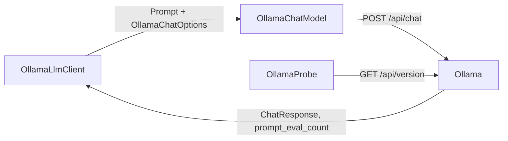

# TD13 data flow

No data flow changes. The request to Ollama (`POST /api/chat`: `model`, `num_ctx`, `num_predict`, `temperature` 0.2, `keep_alive` 10m, `think:false`, `tools:[]`), the answer (`prompt_eval_count`) and the health check (`GET /api/version`) are as in D17. No data is stored differently.

Only the build output changes: fewer jars and no Spring AI auto-configuration on the classpath.
