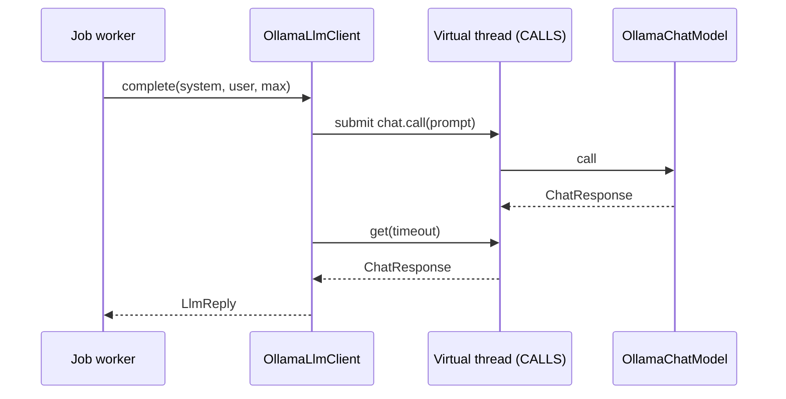
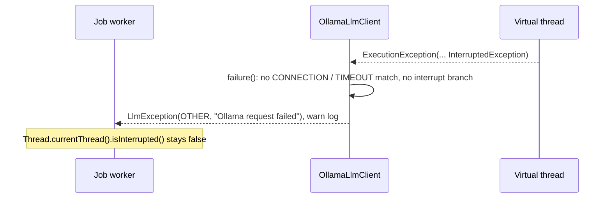
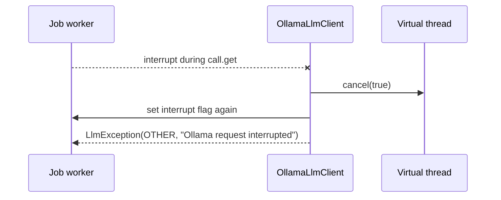

# TD13 flows

## Main: a summary call (unchanged)

## Failure: the call thread raised an `InterruptedException` (changed)

Cause chain of the `ExecutionException` contains an `InterruptedException`. This happens only in the call thread; the flag of the worker is not affected.

## Failure: caller interrupted while waiting (unchanged)

Connection and timeout failures, and `TimeoutException` from `call.get`, are unchanged.
