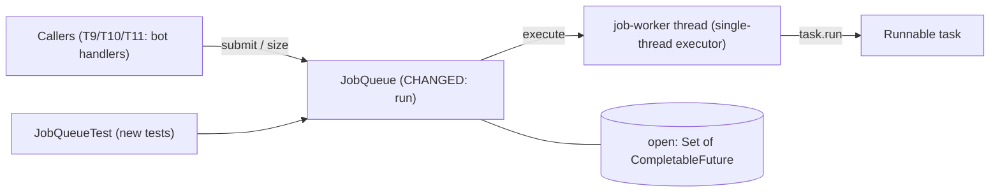

# TD2 components

One component changes: `job.JobQueue` (`src/main/java/com/video2podcast/job/JobQueue.java`). Nothing is
added. `JobQueueTest` gets new unit tests; no other component, config property or file format changes.

**Why there:** the defect is the order of two steps inside `JobQueue.run`: the task's future is completed
in the `try` block, and the task leaves the `open` set only in `finally`. `size()` reads `open`, so for a
short moment it still counts a task whose future is already done. Any caller that reads `size()` after
`get()` or inside a `whenComplete` callback can see the stale value. T11 will show `size()` as the queue
position, so the fix belongs in the queue, not in a bounded wait in the test.

