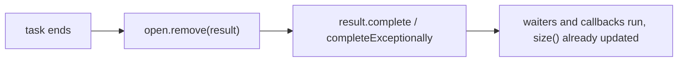

# TD2 data flow

No data is persisted and no format changes. The only state is the in-memory `open` set of futures,
which backs `size()`.

The change is the order of two operations on that state when a task ends:

| Step | Before | After |
|---|---|---|
| 1 | complete the future (callbacks and `get()` waiters run) | remove the future from `open` |
| 2 | remove the future from `open` (in `finally`) | complete the future |

Invariant after the change: when `JobQueue.run` completes a task's future, `open` no longer contains
it, so a waiter or `whenComplete` callback triggered by that completion sees `size()` without it. The
invariant does not cover completion or cancellation by a caller of the returned future, or by `close()`.

`abandonUnfinished()` (called from `close()`) is unchanged: it cancels the future and then removes it.
That is the shutdown path, not the task-end path, and no caller reads `size()` there. It is out of
scope.
