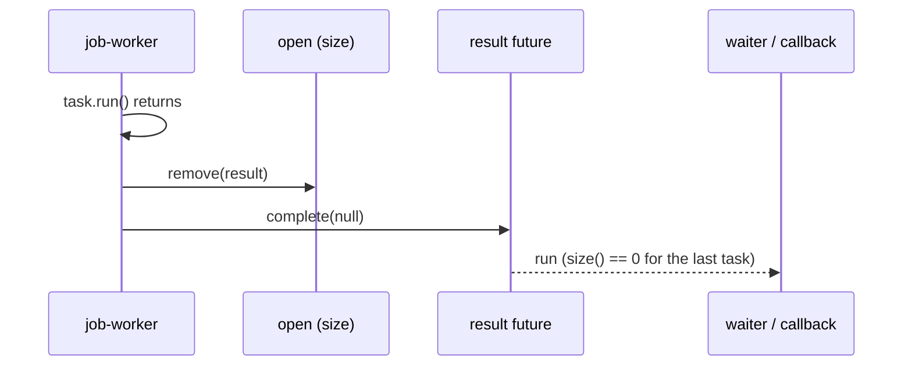
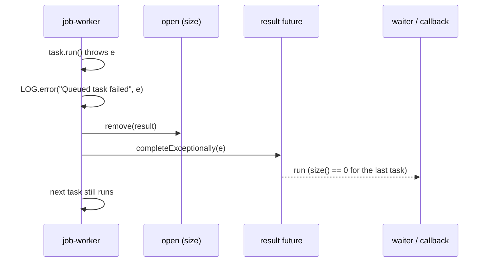

# TD2 flows

All three flows are the end of one task in `JobQueue.run`. "Waiter" is a thread blocked in `get()` or a
`whenComplete` callback.

## Success


## Failure: task throws RuntimeException


## Failure: task throws Error
```mermaid
sequenceDiagram
  participant W as job-worker
  participant Q as open (size)
  participant F as result future
  participant C as waiter / callback
  W->>W: task.run() throws Error
  W->>Q: remove(result) (finally)
  W->>F: completeExceptionally(IllegalStateException "Queued task ended abnormally")
  F-->>C: run (size() == 0)
  W->>W: Error keeps propagating out of run; executor replaces the dead worker thread
```

## Already-done future (cancelled by `abandonUnfinished`)
`run` skips the task. `open.remove` and the completion call are no-ops on state that is already final;
behaviour is unchanged.
