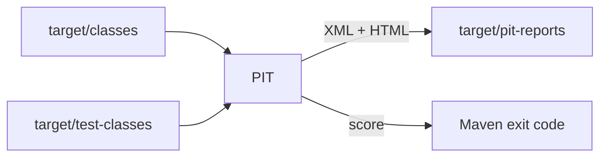

# TD3 data flow

No application data changes. The only data is the build's.

| Data | From → to | Format | Where stored |
|---|---|---|---|
| `target/classes` | Maven compile → PIT | class files | `target/` |
| `target/test-classes` (unit tests, plus IT classes when the `it` profile is on) | Maven test-compile → PIT | class files | `target/` |
| coverage of each test per line | PIT minion JVM → PIT main | in-memory / temp files in `target/pit-reports` | `target/` |
| mutation report | PIT → developer, reviewers | `mutations.xml` and `index.html` tree | `target/pit-reports/` (flat directory, `timestampedReports=false`) |
| mutation score | PIT → Maven | integer percent compared with `mutationThreshold` | build log, exit code |

`target/` is already ignored by git; the report is never committed. There is no history file (`withHistory` off), so each run is full and reproducible.

