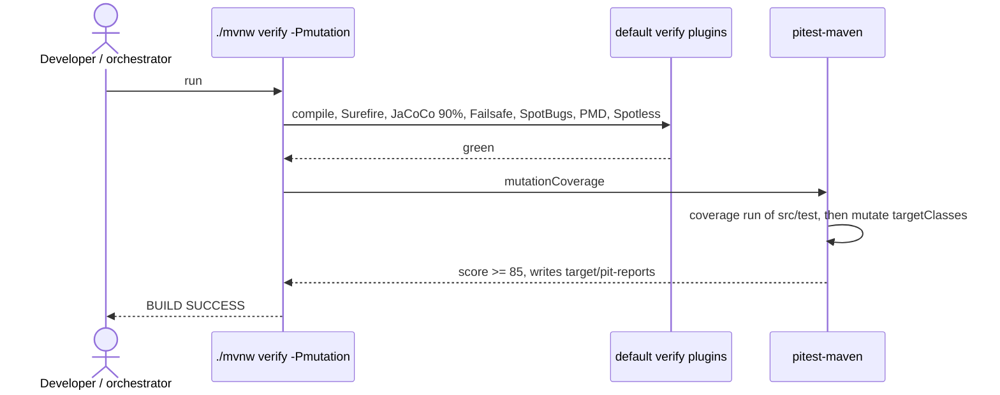
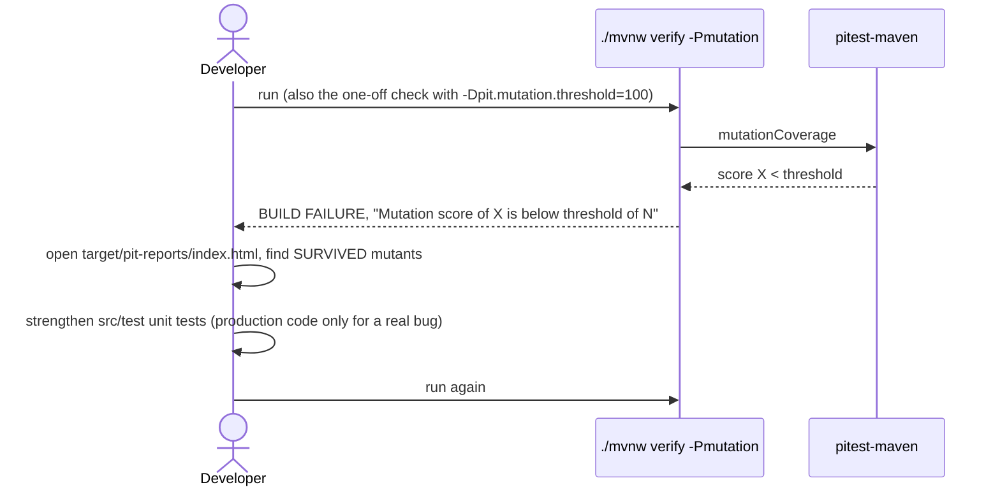
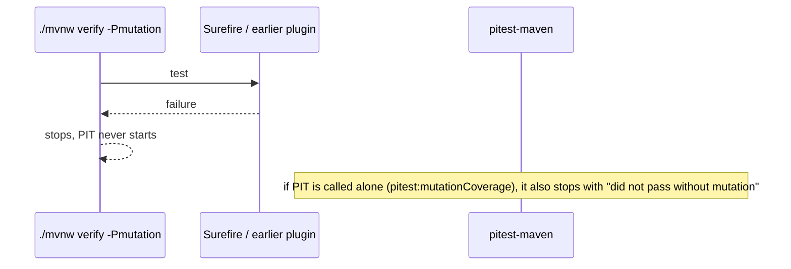
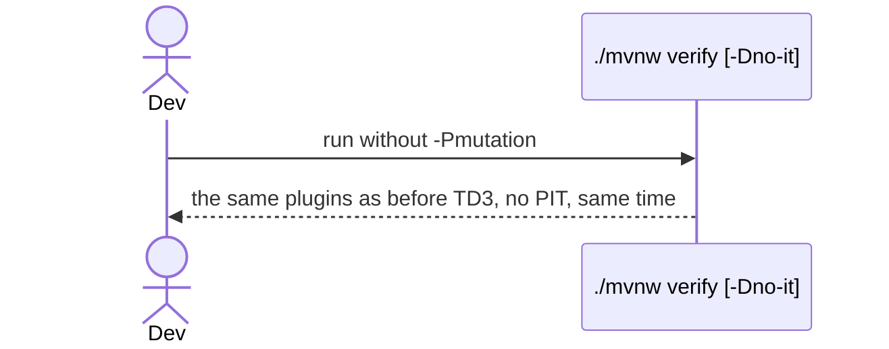
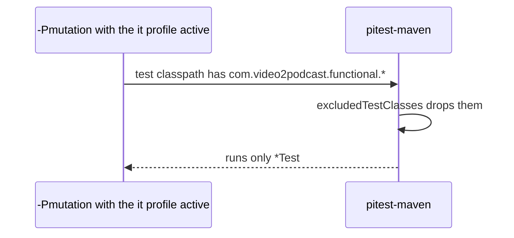

# TD3 flows

## F1: main flow, score at or above the threshold

## F2: failure, score below the threshold

## F3: failure, a unit test is red before mutation

## F4: default builds are unchanged

## F5: IT classes on the test classpath

